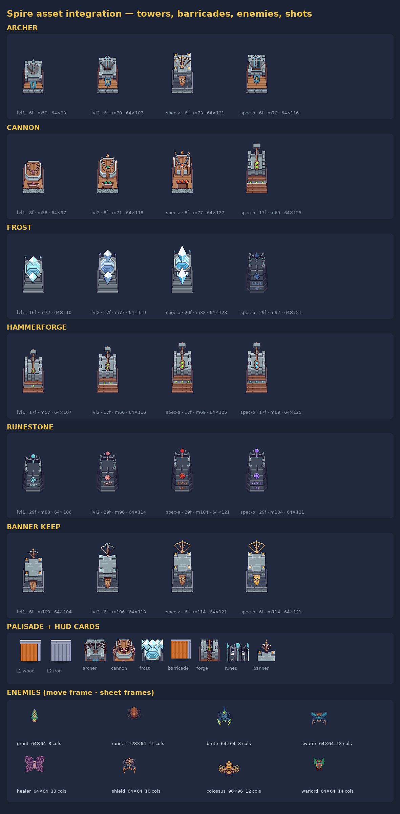
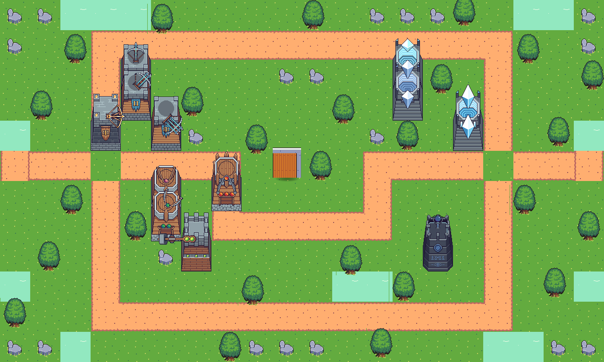
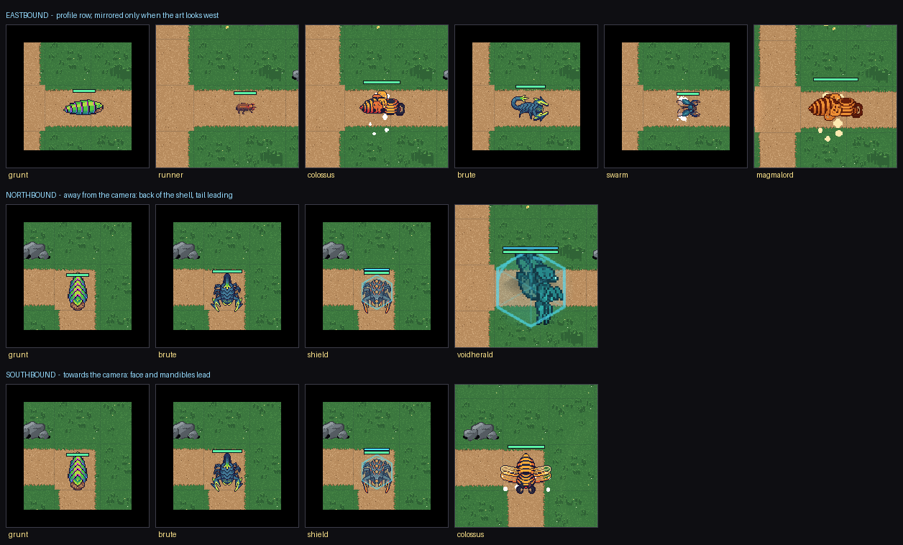

# Asset Integration — Foozle "Spire" art set

This document records exactly which third-party files the game ships, where each
one came from, and how it is used. It replaces the earlier placeholder art
(Kenney "Tower Defense Top Down" plus procedural canvas textures).

Every file listed here is **CC0 1.0 Universal** (public domain dedication).
Attribution is not required; the artist is credited voluntarily.

- Artist: **David / chroma_dave**, commissioned and distributed by **Foozle**
  (<https://foozlecc.itch.io/>)
- Licence text: <https://creativecommons.org/publicdomain/zero/1.0/>
- Commercial use is permitted; each pack's `Readme.txt` states the CC0 terms.

## 1. Source packs

| Pack | itch.io page | Shipped archive | What we use |
| --- | --- | --- | --- |
| Spire Tower Pack 1 | <https://foozlecc.itch.io/spire-tower-pack-1> | `Foozle_2DS0017_Spire_TowerPack_1.zip` | Towers 01–02 (base + weapon + projectile + impact) |
| Spire Tower Pack 2 | <https://foozlecc.itch.io/spire-tower-pack-2> | `Foozle_2DS0018_Spire_TowerPack_2.zip` | Towers 03–04 |
| Spire Tower Pack 3 | <https://foozlecc.itch.io/spire-tower-pack-3> | `Foozle_2DS0019_Spire_TowerPack_3.zip` | Towers 05–06 |
| Spire Enemy Pack 1 | <https://foozlecc.itch.io/spire-enemy-pack-1> | `Foozle_2DC0027_Spire_EnemyPack_1_Flying.zip` | Firewasp (boss), Flying Locust (boss), Clampbeetle, Voidbutterfly |
| Spire Enemy Pack 2 | <https://foozlecc.itch.io/spire-enemy-pack-2> | `Foozle_2DC0028_Spire_EnemyPack_2_Ground.zip` | Leafbug, Firebug, Scorpion, Magma Crab |
| Spire Tileset 1 | <https://foozlecc.itch.io/spire-tileset-1> | `Foozle_2DT0012_Spire_Tileset_1.zip` | Grass, road, rock, water, foliage, palisade parts |

The original archives stay outside the repository. Only the files below are
committed, all under `src/assets/spire/` (unmodified sources) and
`public/assets/` (cropped/derived runtime art).

### Effect packs (Kenney, CC0)

The Spire packs ship nine small impact puffs and nothing else, so every hit in
the game looked the same. Two more packs fill that gap — both CC0, fetched from
the `shorepine/kenney` mirror at a pinned commit:

| Pack | What we use | Runtime |
| --- | --- | --- |
| [Explosion Pack](https://kenney.nl/assets/explosion-pack) | Regular, Simple, Sonic, Pixel and Ground explosion (9 frames each) | `fx-impact-<element>.png`, `fx-ground-blast.png`, `fx-shockwave.png` |
| [Particle Pack](https://kenney.nl/assets/particle-pack) | muzzle, fire, flame, spark, star, circle, light, magic, smoke, trace, twirl, dirt, scorch, symbol | 18 `fx-*` particle textures for the emitters |

Raw frames live in `src/assets/kenney/fx/` (1.4 MB, provenance in
`PROVENANCE.json`, licence in `LICENSE-CC0.txt`). `scripts/build_fx_assets.py`
downsamples the 512 px particle singles, lays each explosion set into one strip
on a uniform frame box, and re-grades every strip through an element ramp. The
result is `public/assets/fx/` plus the generated `src/data/fxManifest.js`.

| Element | Source set | Frame | Why this ramp |
| --- | --- | --- | --- |
| `physical` | Pixel explosion | 96 px | crisp, tiny — an arrow should not explode |
| `explosive` | Regular explosion | 192 px | gold/orange star burst sized to a splash radius |
| `fire` | Simple explosion | 160 px | ember ring, reads as molten stone |
| `frost` | Regular explosion | 176 px | ice blue, keeps the star silhouette |
| `lightning` | Simple explosion | 160 px | white-yellow, snappier frame rate |
| `arcane` | Simple explosion | 176 px | violet, slower playback |
| `true` | Regular explosion | 176 px | magenta — the "ignores armour" colour |

`fx-shockwave` and `fx-implosion` are the same Sonic sheet forward and reversed;
`fx-nova` (ice shards) and `fx-levelup` (gold ring + glyph) are generated
procedurally in the build script.



That sheet is generated, not hand-assembled: `python3 scripts/make_asset_preview.py`
reads the slot geometry from `src/data/towerVisuals.js`, composites every tower
the way the game does and re-renders the enemy strips straight from
`src/data/spireManifest.js`, so it can never drift from the shipped art.

The composed battlefield (terrain autotiles, towers, palisade and props, drawn
by a canvas port of the in-game placement rules):



## 2. Tower mapping

Game slots are `lvl1 → lvl2 → spec-a / spec-b`. Art data lives in
[`src/data/towerVisuals.js`](../src/data/towerVisuals.js); the generator is
[`scripts/build_spire_assets.py`](../scripts/build_spire_assets.py).

| Game tower | Art family | Slots | Reads as |
| --- | --- | --- | --- |
| **Ballista Tower** (`archer`) | Tower 01 (L1, L2, L3), Tower 06 (L3) | `t01_l01`, `t01_l02`, `t06_l03`, `t01_l03` | Stone platform + rotating ballista with bolt arms |
| **Boulder Sling** (`cannon`) | Tower 03 (L1, L2, L3), Tower 04 (L3) | `t03_l01`, `t03_l02`, `t03_l03`, `t04_l03` | Timber platform + counterweight sling; the level-3 branch becomes a wall-mounted swivel gun |
| **Frost Bastion** (`frost`) | Tower 02 (L1, L2, L3), Tower 05 (L3) | `t02_l01`, `t02_l02`, `t02_l03`, `t05_l03` | Shrine bowl + levitating ice crystal; the level-3 branch is a rune obelisk with a conductor orb |
| **Hammerforge** (`forge`) | Tower 04 (L1, L2, L3) | `t04_l01` → `t04_l02` → `t04_l03` / `t04_l03` + storm remap | Stone keep with a counterweight hammer; the Thunderforge branch swaps the green gems for electric blue |
| **Runestone** (`runes`) | Tower 05 (L1, L2, L3) | `t05_l01` → `t05_l02` → `t05_l03` / `t05_l03` + arcane remap | Obsidian rune keep with a levitating orb; the Arcane Nova branch shifts the crimson runes to violet |
| **Banner Keep** (`banner`) | Tower 06 (L1, L2, L3) | `t06_l01` → `t06_l02` → `t06_l03` / `t06_l03` + gold remap | Limestone keep flying a banner; the Muster Camp branch recolours the blue pennant to royal gold |
| **Palisade** (`barricade`) | Tileset 1 walkway planks + stone coping | one sprite per tier | Vertical stakes with a stone cap, standing on the road |

### The five engineer lines (authored, not imported)

The Spire packs stop at six keeps, so the engineer roster is drawn from scratch
by [`scripts/build_engineer_towers.py`](../scripts/build_engineer_towers.py) in
the same 64 px side-view idiom (brickwork masked to a silhouette, iron banding,
one accent colour per line). Nothing is recoloured: **every one of the 40 slots
is a separate drawing**, and the canvas grows with the tier.

| Line | Level 1 | Level 3 (a / b) | Level 5 (a3 / b3) | Signature machinery |
| --- | --- | --- | --- | --- |
| **Iron Crossbow** | 94 px | 124 / 116 px | 152 / 148 px | windlass wheel, second wheel at 4, spire at 5 |
| **Clockwork Repeater** | 94 px | 124 / 116 px | 152 / 148 px | copper boiler, twin boilers at 4, crane arm at 5 |
| **Pitchfire Siphon** | 94 px | 124 / 116 px | 152 / 148 px | fuel drum, twin drums at 4, burner bowl at 5 |
| **Venom Still** | 94 px | 124 / 116 px | 152 / 148 px | glass vat, second vat at 4, overflow bulb at 5 |
| **Harpoon Winch** | 94 px | 124 / 116 px | 152 / 148 px | winch drum + spare spears, 3 spears at 4, teal halo at 5 |

Weapons are six-frame horizontal strips in a 128 × 128 frame with the pivot at
`(64, 100)`; the art is scaled per slot (0.60 → 0.78) so the muzzle lands at
≈1.05–1.35× the keep's height, matching the Spire sheets. The generator writes
`src/data/engineerTowerArt.js`, and `towerVisuals.js` folds it into
`TOWER_VISUALS` plus an exact `MUZZLE_OFFSET` per slot (`muzzleY` is measured
from the drawn tip, never guessed).

Shots and effects come from
[`scripts/build_engineer_fx.py`](../scripts/build_engineer_fx.py):

| Line | Projectile | Impact strip | Muzzle |
| --- | --- | --- | --- |
| crossbow | `proj-bolt`, `proj-bolt-heavy` | `fx-line-crossbow-impact` (needle burst) | triangular flash |
| gatling | `proj-bullet` | `fx-line-gatling-impact` (casings + cone) | brass cone |
| flamer | `proj-flame` | `fx-line-flamer-impact` (tongues + scorch) | ember spout |
| venom | `proj-acid` | `fx-line-venom-impact` (bubbles + pool) | green glob |
| harpoon | `proj-harpoon` | `fx-line-harpoon-impact` (spear + splinters) | teal diamond |

The impact strips re-tint the shipped Kenney CC0 bursts (`blast`, `ember`,
`arcane`, `ground`) with frame 0 skipped and alpha capped below white, so a
burst can never strobe — the same rule the element strips follow.

Tower 04, 05 and 06 each ship a single level-3 sheet, so the two branches of
those lines share it and are told apart by a palette remap (`STORM_REMAP`,
`ARCANE_REMAP`, `GOLD_REMAP` in the generator). Remaps are keyed by *output
stem*, not slot index, so only the second branch is recoloured — `banner-spec-a`
keeps the stock blue pennant. Mechanics are untouched: ranges, damage,
cooldowns, upgrades, targeting, hitboxes and the DSALGO pathfinding all use the
same numbers as before the restyle. Only presentation changed.

### Ascended tiers (levels 4–5)

Levels 4 and 5 keep their branch's silhouette but ship their own textures:
`base_<line>-spec-a2.png`, `-spec-a3.png` and the matching weapons. The script
re-grades the level-3 art through the line's element ramp, adds a rim light and,
at level 5, paints a power ring on the plinth.

**Tier geometry.** A re-grade on its own was rejected by playtesting: the result
read as "same tower, warmer", never as an upgrade. Every tier above 1 therefore
also gains parts, drawn by `scripts/build_tower_decor.py` (24 sprites, generated
metadata in `src/data/towerDecor.js`) and attached at runtime by
`Tower.refreshDecorations()`:

| Tier | Sprite | Anchor |
| --- | --- | --- |
| 2 | `parapet.png` (keeps) / `rail.png` (engineer) + `pennant-<line>.png` ×2 | crown behind the keep's top, flags on its edges |
| 3 | `plinth.png` + `cloth-<line>.png` | footing at the ground line, standard hung under the crown |
| 4 | `brazier.png` + `flame-0..2.png` ×2 | base corners, ADD blend, 120 ms frame cycle |
| 5 | `crystal-<line>.png` ×2 | hovering above the crown, opposite-phase bob |

**Eleven lines, two crowns.** All eleven lines ship their own pennant, standard
and tier-5 sprit (`DECOR_ART`). The six Spire keeps fly a plain cloth under a
stone merlon crown; the five engineer lines fly a **larger, stamped** cloth
(18 × 36 vs 14 × 30) under an **iron gun rail** (`rail.png`) with a barrel
cradle, because a repeater under castle battlements looked wrong. Each engineer
mark is a real silhouette — bolt, cog, flame, bubble cluster, barbed hook — and
each tier-5 sprit is a matching shape (lance tip, gear, jagged ember, bubble
cluster, barbed shard) drawn on a taller canvas than the keep shard.
`tests/tower-decor.test.js` decodes the alpha channel of the five sprits and
fails if any two share a silhouette, so "recolour and call it different" cannot
sneak back in.

Rebuilding the keeps from the source packs was still rejected: every pivot,
mount height and muzzle offset in `towerVisuals.js` is calibrated to the
level-3 sheet (`fw`/`fh`/`px`/`py`/`mount`), and a new canvas size would mean
re-measuring 48 sprites by hand. Decoration layers change the silhouette without
touching a single measured value.

`TOWER_VISUALS` derives the four ascended slots from `spec-a`/`spec-b`, so
`SLOTS` is eight entries per line and `BootScene` loads them without a special
case.

### Placement contract

`TOWER_VISUALS[type][slot]` gives, per slot:

- `base` / `weapon` — file names under `public/assets/towers/`
- `fw`, `fh`, `frames` — weapon spritesheet geometry (frames are horizontal)
- `px`, `py` — the weapon's rotation pivot inside its frame
- `mount` — how far above the tile's ground line that pivot sits

The base sprite is bottom-anchored at the tile's ground line; the weapon is
drawn with its pivot at `(tileCentreX, tileBottomY − mount)` and rotates about
it. `MUZZLE_OFFSET` lists where each weapon's projectile leaves the art
(relative to the pivot), so shots start at the weapon rather than the tile
centre. Frost crystals never rotate (`NON_ROTATING_TYPES`) and simply bob.

### Projectiles and impacts

| Game projectile | Art | Impact strip |
| --- | --- | --- |
| `arrow` / `sniper` | `proj-arrow`, `proj-sniper` (Tower 01) | `impact-arrow` |
| `rapid` | `proj-rapid` (Tower 06) | `impact-rapid` |
| `cannonball` | `proj-cannonball` (Tower 03) | `impact-cannon` |
| `frost` | `proj-frost`, `-2`, `-3` per tier (Tower 02) | `impact-frost`, `-2`, `-3` |
| `lightning` | `proj-lightning` (Tower 05) | `impact-lightning` |
| `banner` | `proj-banner` (golden standard bolt) | `fx-line-banner-impact` |
| any line, L4 | `proj-line-<line>-4` | `fx-line-<line>-impact` |
| any line, L5 | `proj-line-<line>-5` | `fx-line-<line>-impact` |

The tiered keys come from the generated `src/data/projectileArt.js`
(`projectileArtFor(line, level)`), so `Tower` never hard-codes a file name; if a
texture is missing the shot falls back to the branch's `slotTexture`.

The Spire impact strips are the fallback. The shipped effects come from the
Kenney library above (`src/systems/Vfx.js`), which picks a strip by *damage
type* rather than by projectile art, so a repainted tower still lands with the
right element.

## 3. Enemies

`src/data/spireManifest.js` is generated from the real sheets and records frame
size plus the frame count of each animation band.

| Game archetype | Creature | Sheet | Frames (idle / move / death) |
| --- | --- | --- | --- |
| `grunt` | Leafbug | `enemy-grunt.png` | 6 / 8 / 7 |
| `runner` | Firebug | `enemy-runner.png` (128×64 frames) | 6 / 8 / 11 |
| `brute` | Scorpion | `enemy-brute.png` | 8 / 8 / 8 |
| `swarm` | Clampbeetle | `enemy-swarm.png` | 8 / 8 / 13 |
| `healer` | Voidbutterfly | `enemy-healer.png` | 6 / 4 / 12 |
| `shield` | Magma Crab | `enemy-shield.png` | 8 / 8 / 10 |
| `boss-colossus` | Firewasp | `enemy-colossus.png` (96×96 frames) | 12 / 8 / 12 |
| `boss-warlord` | Flying Locust | `enemy-warlord.png` | 12 / 8 / 14 |
| `boss-sandwyrm` | Scorpion, **2×** | `enemy-sandwyrm.png` (128×128 frames) | 8 / 8 / 8 |
| `boss-frostwarden` | Magma Crab, **2×** | `enemy-frostwarden.png` (128×128 frames) | 8 / 8 / 10 |
| `boss-magmalord` | Firewasp, **2×** | `enemy-magmalord.png` (192×192 frames) | 12 / 8 / 12 |
| `boss-prismlord` | Void Butterfly, **3×** | `enemy-prismlord.png` (192×192 frames) | 6 / 4 / 12 |
| `boss-obsidian` | Clampbeetle, **3×** | `enemy-obsidian.png` (192×192 frames) | 8 / 8 / 13 |
| `boss-voidherald` | Flying Locust, **3×** | `enemy-voidherald.png` (192×192 frames) | 12 / 8 / 14 |

### How a Spire strip is laid out

Nine rows, and the row is a **direction**, not a colour variant:

| Rows | Clip | Row order |
| --- | --- | --- |
| 0–2 | `idle` | 0 = south (towards the camera), 1 = north (away), 2 = profile |
| 3–5 | `move` | same three directions |
| 6–8 | `death` | same three directions |

Frame counts are uniform inside each clip across all three directions, and they
are read from the manifest — never assumed. `BootScene.createEnemyClips()` turns
row *d* into `<texture>-d<d>-<clip>`; the bare `<texture>-<clip>` keys alias the
south row.

`Enemy.faceTravel()` therefore picks a **row**, and the sprite's `rotation` stays
`0` in every lane. That is the whole fix for "the monster walks on its side":
rotating top-down art by 90° maps its front-to-back axis onto the screen's
left-to-right axis, so a northbound creep ends up lying flat while still
technically "aimed" at the lane. The sprite also never has to un-rotate on a
corner, so the pose change is a single frame cut.

The profile row is the one place the artist was not consistent: some creatures
are drawn looking **east**, some looking **west**. Rotating cannot fix that and
neither can a single global constant, so the direction is declared per sheet in
`scripts/build_spire_assets.py` and travels into the manifest as
`profileFacing`. Mirroring is then decided against the art rather than against
the screen: `flipX = (travelX < 0) ≠ (profileFacing === 'west')`.

| Art faces east | Art faces west |
| --- | --- |
| grunt, runner, healer, colossus, warlord, magmalord, prismlord, voidherald | brute, swarm, shield, sandwyrm, frostwarden, obsidian |



*Real render, headless Chromium. Top: crossing a horizontal lane on the profile
row — the scorpion and the clam beetle are mirrored because their art is inked
looking west. Middle: walking away from the camera. Bottom: walking towards it.
Every cell reports `rotation = 0`.*

Bosses are scaled and re-graded from those same strips, so they carry the source
creature's facing instead of being re-measured: `sandwyrm`/`obsidian` look west
with `brute`/`swarm`, `frostwarden` with `shield`, and `magmalord`/`prismlord`/
`voidherald` look east with `colossus`/`healer`/`warlord`. `ENEMY_PROFILE_INHERITS`
in the generator is the single place that mapping lives.

### Flare monsters (CC-BY-SA 3.0)
The Spire set is all insects, so a second pack supplies the bodies that are not
bugs. Six creatures come from [FLARE](https://github.com/clintbellanger/flare-game)
(© Clint Bellanger and contributors, CC-BY-SA 3.0 — full text in
`src/assets/flare/LICENSE.txt`, provenance and modifications in
`src/assets/flare/README.md`).

Flare ships packed atlases with an `.txt` naming a rectangle and a foot offset
for every frame of eight facings. `scripts/extract_flare_enemies.py` lifts a
single facing, drops the baked ground shadow, and recomposites the clips into
the same 9-row idle/move/death strip the Spire sheets use — which means biomes,
tiers and the manifest apply with no special case in the game.

One field cannot be shared with the Spire set. A Spire strip is **three clips ×
three directions** (see above), so a creep has a drawing for every way it can
travel. Flare's creatures stand on the ground and face the camera; they ship one
pose, so all six declare `directional: false` and are mirrored left/right
instead. Eight real facings exist in the source and would fix the north/south
case, but copying them into every biome × tier sheet multiplies the creature
sheets fourfold — about 17 MB per direction set in `public/assets/enemies` — for
a difference the player only sees walking away from the camera. The front-on
contract buys the readable half for free.


| Game archetype | Flare creature | Sheet (frame) | Frames (idle / move / death) |
| --- | --- | --- | --- |
| `thrall` | Zombie | `enemy-thrall.png` (65×65) | 4 / 8 / 6 |
| `raider` | Goblin | `enemy-raider.png` (62×62) | 4 / 8 / 6 |
| `bonearcher` | Skeleton archer | `enemy-bonearcher.png` (80×80) | 4 / 8 / 6 |
| `boss-ironhorn` | Minotaur | `enemy-ironhorn.png` (103×103) | 8 / 8 / 8 |
| `boss-ashwing` | Wyvern | `enemy-ashwing.png` (122×122) | 8 / 8 / 8 |
| `boss-gravesworn` | Skeleton knight | `enemy-gravesworn.png` (114×114) | 4 / 8 / 6 |

The generator measures each sheet's ink to size it on screen. Spire sheets hold
one silhouette across every frame, so frame 0 is exact; Flare's creatures change
pose far more (the wyvern folds its wings to 68×40 and spreads them to 108×65),
so `AVERAGE_MEASURE` takes the mean box over the idle and move rows instead.
Measuring the folded frame made the whole animation 1.8× too large and clipped
the wings off-screen.

Bosses take a *partial* grade (50–55 % toward their element ramp) rather than
the full duotone the Spire giants get: the Flare sheets are painted with armour
detail, and mapping them onto four flat stops turns a minotaur into a silhouette.
Creeps get the same per-biome re-grade as every other creep, so a thrall is
frozen blue on the ice map and charred on the Caldera.

### Boss sheets
The campaign bosses reuse the elite silhouettes, upscaled 2–3× with
nearest-neighbour (so the pixel grid survives) and **duotoned** onto a
per-boss ramp — `duotone()` in the generator maps every pixel's luminance
through four stops:

| Boss | Source silhouette | Ramp (dark → light) |
|---|---|---|
| Dune Tyrant | Scorpion ×2 | `#2A1A0C → #8A5A2A → #FFD98A → #FFF3D0` |
| Frost Warden | Magma Crab ×2 | `#10202E → #33607F → #9FD4EF → #F2FBFF` |
| Magma Regent | Firewasp ×2 | `#1E0806 → #8C2A0E → #FFA23C → #FFE9B0` |
| Prism Warden | Void Butterfly ×3 | `#140A2A → #4A2E8C → #B892F0 → #F4ECFF` |
| Void Herald | Flying Locust ×3 | `#05070F → #123B45 → #2FB6A8 → #B9FFF2` |
| Obsidian Behemoth | Clampbeetle ×3 | `#090A14 → #2A2350 → #6F5BD6 → #C9BEFF` |

A hue rotation alone was not enough: the source sheets carry several hue
families (carapace, eyes, highlights), so rotating them kept the original
identity. Dropping to one ramp makes a boss read as its own creature at a
glance while keeping the pack's shape language.

### Biome re-grade × wave tier × palette

Each strip holds nine rows: idle, walk and death, each in the three directions
above. Frame size differs per creature (the Firebug sheet is 128×64 per frame,
the Firewasp 96×96), so the manifest also records the drawn width/height of the
art, and sprites are scaled by that drawn width to match the collision radius.
No rotation is applied — the direction row supplies the pose.

One strip on its own was not enough on screen. Two things were measured and
fixed at the root:

1. **The three row variants are nearly identical.** Comparing frame 0 of row 0
   with rows 1 and 2 shows only ~186 of ~3,576 inked pixels differ (≈5 %). That
   measurement was originally read as "three palette variants" — it is in fact
   three *directions* of the same pose, which is why swapping rows per wave was
   both invisible and, later, the reason half the horde walked sideways.
2. **A single re-grade per biome cannot express escalation.** Waves 1 and 6
   looked the same shade.

So the generator now bakes a sheet per **(creature × battlefield × tier)** and
`spireManifest.js` exports the texture keys as `ENEMY_SKINS`:

| Tier | Waves | Extra work on top of the biome re-grade | Scale | Glow |
|:-:|:-:|---|:-:|:-:|
| 0 base | 1–2 | none (pure biome re-grade) | 1.00 | — |
| 1 elite | 3–4 | saturation ×1.38, lightness ×1.16, gold contour | 1.08 | 0.22 |
| 2 champion | 5+ | ember ramp under the biome hue, saturation ×1.55, ember contour **grown one pixel outwards** | 1.16 | 0.34 |

The contour is structural, not a tint: `rim_light()` recolours every silhouette
pixel that touches empty space and, for champions, paints the ring of pixels just
outside the silhouette, so a champion's body is literally larger. `Enemy` then
multiplies `baseScale` by the tier scale and, from tier 1 up, adds an additive
brood-coloured glow ellipse behind the sprite (`createBroodGlow`, pulsing on a
760 ms tween for champions, 1200 ms for elites). `ENEMY_TIERS` in the manifest
carries the scale/glow numbers so the renderer holds no magic values.

Bosses keep their single heroic sheet — escalation is a creep feature, and an
ember contour on the Frost Warden would fight its element. `textureFor()` returns
`enemy-<boss>` for any key without a `ENEMY_SKINS` entry.

Per-wave palette rows are still used on top of this (rows 0–2 / 3–5 / 6–8 in two-
wave blocks), so the horde keeps changing inside a tier.

Display names in `src/data/enemyData.js` stay thematic; the insect artwork is
accepted as part of the "Spire" look.

## 4. Terrain

Every tile is 64×64, **painted procedurally** by `scripts/terrain.py` from the
biome's own palette rather than re-graded from one pack tile. A colour LUT over
`grass.png` was the first attempt and it could not make a desert read as sand:
it kept the pack's leaf detail and only moved the hue. `build_tiles()` in
`build_spire_assets.py` is now a thin wrapper that writes what `terrain.py`
returns:

| Base key | Painter | Notes |
|---|---|---|
| `grass`, `grass_2`, `grass_3` | `build_ground` | flat base + 14 % single-pixel dither + hand-placed blade clumps; three variants share one macro pattern so the board never shows a grid |
| `road_0` … `road_15` | `build_road` | 4-bit autotile (N=1, E=2, S=4, W=8), wobbled fringe, **alpha-composited** — the lane is drawn on top of the ground, nothing is painted into the fringe |
| `water_0` … `water_15`, `water` | `build_water` | same autotile contract; depth by distance from the shoreline (3 bands), light foam rim, rounded corners on single-cell ponds |
| `rock`, `rock_2` | `build_rock` | polar-blob boulder clusters with top-left lighting, hairline cracks and grass/gravel tufts at the base |
| `decor_tuft` / `decor_bloom` / `decor_shard` | `build_decor` | 32×32 scatter props (blade clumps, flowers, stone shards), different per biome |
| `foliage` | `build_foliage` | one landmark per battlefield: the Spire oak in the grassland, saguaro cacti in the desert, snow-laden firs on the ice, ember-lit charred deadwood on the volcano |

Two fixes are worth recording because both were visible on screen:

- **Seams between connected tiles.** `_fringe().inside()` probed past the tile
  edge by wrapping (`x % size`), which answered "masked" for open ground and
  painted a false rim on every internal seam. Out-of-range probes now answer from
  the autotile mask instead.
- **Painting ground colour into the fringe** desynced from the biome ground
  (bluish seams on ice) and forced a per-neighbour recomputation. The fringe is
  transparent and `GameScene.renderBattlefieldMap()` layers ground → lane/water →
  decor, which is the root-cause fix.

### Biome identity
`RAMPS`, `ROAD_RAMPS`, `WATER_RAMPS` and `ROCK_RAMPS` in `terrain.py` hold the
palettes; `suffix()` maps a theme to its file suffix and `seed_for()` (crc32, not
`hash()`, which is randomised per process) keeps every build byte-identical.

| Theme | Ground | Lane | Water | Landmark |
|---|---|---|---|---|
| grassland | green dither, blade clumps, flowers | warm clay | dark teal pond | Spire oak |
| desert | ochre sand, cracked shadows | trodden dark earth | deep oasis aqua | saguaro cactus |
| ice | slate blue, wind streaks, frost needles | dark slate | frozen navy | snowy fir |
| volcanic | near-black ash, ember flecks, magma cracks | ashen basalt + ember seams | bright magma | charred deadwood |
| crystal | indigo basalt, amethyst veins, glitter | polished pale quartz | teal mana pool | crystal prism cluster |

### Readability audit
`scripts/terrain.py --contrast` prints a JSON table of surface-vs-ground
separation. The metric is a YCbCr distance with area weights (55/30/10/5 % across
the ramp), because a saturated teal pond on green grass can sit at the same luma
and still be perfectly readable — a pure brightness delta rejects good palettes
and accepts grey mud. `tests/terrain-contrast.test.js` enforces the floor
(≥ 26) and also fails if two biomes end up with the same lane or water value.

### Maps
`src/data/mapData.js` holds four 20×12 ASCII battlefields — `grassland`,
`desert`, `ice` and `volcanic` (a four-step staircase, 31 tiles) — each verified
pathable by the BFS graph. Levels 1–3 use the first three; Endless Siege marches
the volcanic one. `build_tiles()` also renders the 120×72 world-map minimaps from
the same ASCII and the same themed tiles.

### UI art
- `star_gold.png` / `star_empty.png` / `lock.png` — Kenney *Game Icons* white
  silhouettes, tinted (`tint_pixels`) gold, slate and parchment.
- `icon_gem.png` — the Kenney top-down gem prop (`towerDefense_tile183`),
  hue-shifted to violet and centred on a 64 px canvas.
- `map_<theme>.png` — 120×72 minimaps rendered from the *same* ASCII
  battlefields in `src/data/mapData.js` and the *same* themed tiles the game
  loads: one 6 px block per cell, road cells brightened so the lane reads at
  thumbnail size. Adding a level therefore adds a thumbnail for free.

## 5. Known gaps and deliberate choices

1. **No dedicated barricade prop.** Spire Tileset 1 has no single-tile fence or
   spike barrier. The palisade is therefore composed from the walkway's vertical
   planks plus its stone coping, and given a contact shadow. It reads as a
   staked fence rather than a manufactured barricade; a dedicated prop would be
   needed for a stronger silhouette.
2. **Tower 05 L3 ships two animation rows** (96×96 frames: idle on top, firing
   below). The generator keeps the firing row so every weapon sheet is one row.
3. **Archer impact art exists only per tower** (`Weapon - Impact`), not per
   level, so `arrow` and `sniper` share one strip.
4. **No enemy shadow sprites** are shipped in the packs; the existing renderer
   draws none, matching the source game.
5. **Cropped, not repainted.** Bases are trimmed to 64 px wide and weapons are
   recoloured only for the frost/lightning branches (hue remap in the
   generator), so no art is invented.
6. **Every Kenney `towerDefense_tile` is Adam7-interlaced.** The in-repo PNG
   decoder handles all seven passes; a decoder that ignores the interlace byte
   silently returns rainbow noise instead of art (this bit the gem icon first).

## 6. Regenerating the art

```bash
python3 scripts/build_spire_assets.py     # towers/enemies/tiles + spireManifest.js
python3 scripts/build_tower_decor.py      # per-tier decorations + towerDecor.js
python3 scripts/build_projectiles.py      # per-line L4/L5 shots + projectileArt.js
python3 scripts/build_engineer_towers.py  # 5 engineer lines + engineerTowerArt.js
python3 scripts/build_engineer_fx.py      # engineer shots + impacts + muzzles
python3 scripts/build_fx_assets.py        # element + per-line effect atlases
python3 scripts/terrain.py --contrast     # battlefield readability table
```

Requires only the standard library plus the unpacked source packs in
`src/assets/spire/`. The script prints one line per output file — treat that as
the manifest — and rewrites `src/data/spireManifest.js`. Terrain and enemy tiers
are deterministic (crc32 seeding), so a rebuild with no source change produces
identical bytes.
