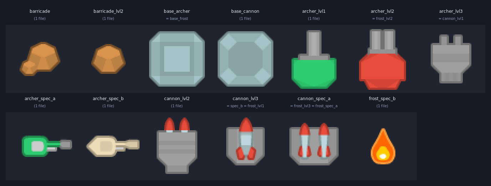
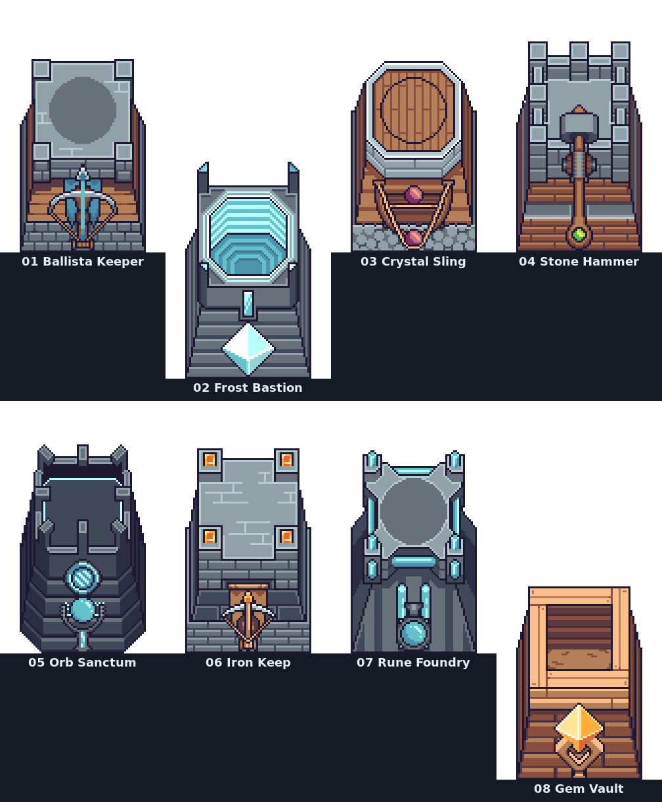
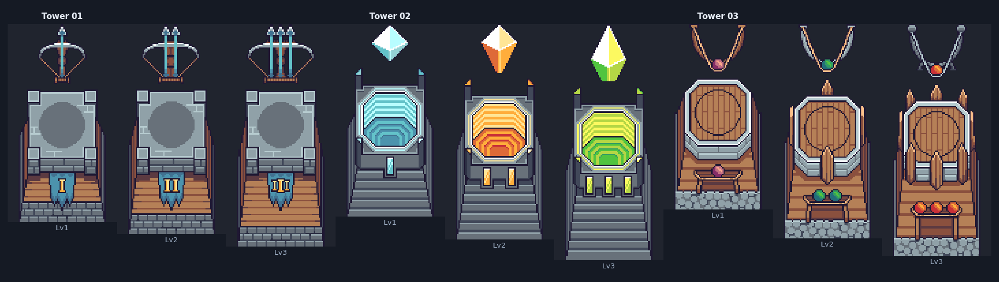
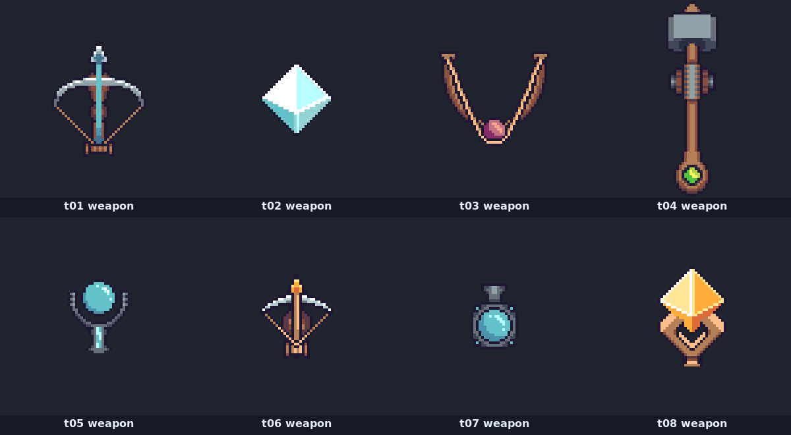
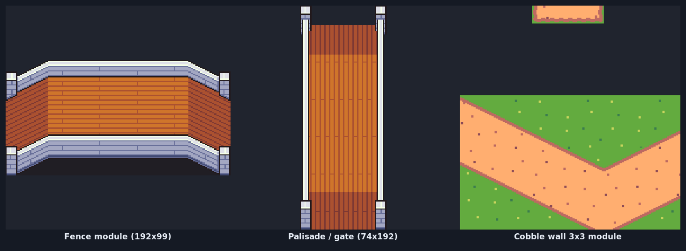
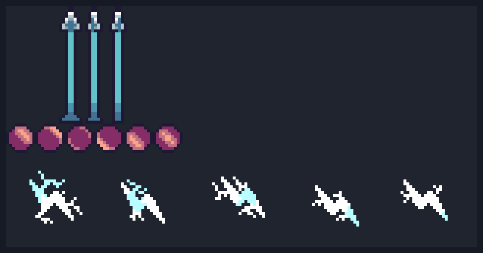
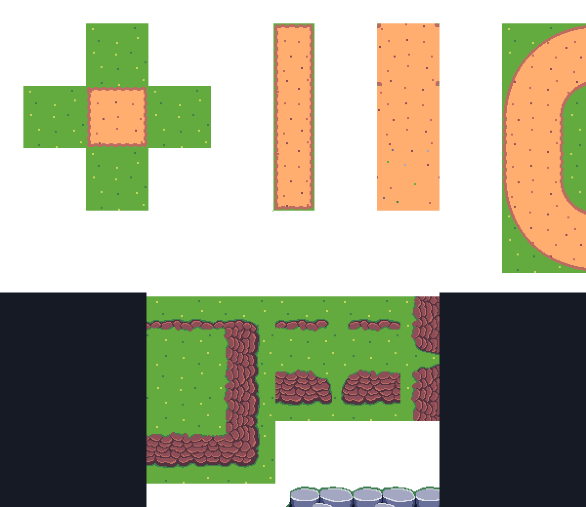

> **Status:** implemented. The delivered art set and its exact file mapping are
> recorded in [asset-integration.md](asset-integration.md).

# Asset research — replacing the Forge Defense tower & barricade art

**Status:** research complete and implemented — see [asset-integration.md](asset-integration.md) for the shipped files.
This document is the "stop point" the brief asked for: verified previews, licences, contents and a
recommended combination. Integration starts only after you pick an option and hand me the files.

Date: 2026-10-24 · Branch: `arena/b175cdcd-tower-defense-web-based`

Figures in this document live in [`docs/asset-research/`](asset-research/). Every image there was
cropped from a **CC0** pack for the purpose of this review.

---

## 0. TL;DR (read this if nothing else)

1. **The current tower art is not custom art.** All 15 tower base/top PNGs and all 10 projectile/tile/
   enemy PNGs are exact pixel matches (RMSE = 0) to tiles in **Kenney's *Tower Defense (Top Down)*
   tile sheet**. That pack has terrain pads, turret *shells*, missiles, tanks and planes — **no archer,
   no ice/crystal tower, no wall/fence**. That is exactly why the placeholders look like a green plug,
   a grey plug, a rocket and a boulder: they are "closest available tile" substitutions.
2. 20 tower PNGs collapse to **13 unique images**, and several are duplicated *across* tower types
   (`archer_lvl3 = cannon_lvl1`, `cannon_spec_a = frost_lvl3 = frost_spec_a`, `base_archer =
   base_frost`, …). Details in §1.
3. **Recommended direction:** one coherent CC0 pixel-art set — **Foozle "Spire"** — = Tower Packs 1–4 +
   Tileset 1 (+ Enemy Packs 1–2 and the Builder Pack for a full restyle). It is authored on a **64 px
   grid**, i.e. **exactly** the game's tile size and tower footprint, so assets drop in at **1:1 with no
   rescaling**. ~12 MB total, free, no attribution required.
4. Every hard requirement is satisfied by that set — including a *visibly bow-armed* tower, an ice-crystal
   spire with shard projectile + shatter impact, and a real wooden fence/palisade for the barricade.
   **The one honest compromise is the Cannon:** Spire contains no gunpowder cannon. See §4.
5. **What I need from you:** pick A1 / A2 / A3 (§5) and either upload the zips or tell me to pull the
   identical CC0 files from the public mirror (§7).

---

## 1. Audit of the current art (why it fails the brief)



*All 20 PNGs in `public/assets/towers/`, deduplicated to 13 unique images. Labels show the files that
share one image.*

Measured provenance — every row is a byte-for-byte/`RMSE 0` match against a tile extracted from
`kenney_tower-defense-top-down` sheet (299 tiles, 1472×832):

| Game asset | Matches Kenney tile | Verdict |
|---|---|---|
| `base_archer.png`, `base_frost.png` | `t_180` | generic stone plinth, no identity |
| `base_cannon.png` | `t_181` | generic stone plinth |
| `tower_archer_lvl1.png` | `t_249` | **green turret shell** — no bow, no archer |
| `tower_archer_lvl2.png`, `tower_frost_lvl2.png` | `t_250` | red twin-barrel shell |
| `tower_archer_lvl3.png`, `tower_cannon_lvl1.png` | `t_203` | grey "plug" shell |
| `tower_archer_spec_a.png` / `_spec_b.png` | `t_291` / `t_292` | green gun barrel / beige barrel |
| `tower_cannon_lvl2.png` | `t_204` | grey shell with fins |
| `tower_cannon_lvl3.png`, `tower_cannon_spec_b.png`, `tower_frost_lvl1.png` | `t_206` | **rocket** shell |
| `tower_cannon_spec_a.png`, `tower_frost_lvl3.png`, `tower_frost_spec_a.png` | `t_205` | twin rocket pod |
| `tower_frost_spec_b.png` | *(Kenney flame, not identical)* | fire drop — the opposite of frost |
| `barricade.png`, `barricade_lvl2.png` | *(no match; nearest RMSE 11 238 / 8 844)* | **orange boulder** — generated placeholder |
| `proj_arrow` / `proj_cannonball` / `proj_frost` | `t_297` / `t_274` / `t_251` | generic Kenney bullets |
| `tiles/grass.png`, `tiles/road.png` | `t_024`, `t_093` | flat Kenney terrain |
| `enemies/enemy_grunt.png` | `t_245` | flat Kenney vehicle/turret art |

Consequences against the four hard criteria:

* **Archer Tower** — a green barrel. No bow, no archer, no ballistic silhouette.
* **Cannon Tower** — a grey plug, then a rocket. Reads as a sci-fi launcher, not artillery; identical to
  the frost tower's level-1 sprite.
* **Frost Spire** — level 1 is a **rocket**, level 3 is a **twin rocket pod**, and the specialisation is a
  **flame**. It literally reads as fire.
* **Road Barricade** — an orange boulder that does not sit on the road perspective and reads as an
  obstacle only by accident.

Also worth noting: the game's own data already promises better than the art —
`src/data/towerData.js` calls the archer levels **"Scout Ballista" / "Twin Ballista"**. The art never
matched that fiction.

---

## 2. Verified sources

Everything below was opened during this session; licence text is quoted from the source page, and
"verified" means I listed the actual files (via the public mirror) and/or cropped the real sheets.

### 2.1 Recommended set — Foozle "Spire" (CC0)

| Pack | Link (official download) | Licence | Contents | Size |
|---|---|---|---|---|
| Spire — Tower Pack 1 | <https://foozlecc.itch.io/spire-tower-pack-1> | **CC0 1.0** ("commercial included", author confirmed in comments) | Towers **01 & 02**, 3 levels each, weapon separate from base, per-level weapon + projectile + impact animations, Aseprite | `Foozle_2DS0017_Spire_TowerPack_1.zip` **343 kB** |
| Spire — Tower Pack 2 | <https://foozlecc.itch.io/spire-tower-pack-2> | CC0 1.0 | Towers **03 & 04** (same structure) | `Foozle_2DS0018_Spire_TowerPack_2.zip` **349 kB** |
| Spire — Tower Pack 3 | <https://foozlecc.itch.io/spire-tower-pack-3> | CC0 1.0 | Towers **05 & 06** | `Foozle_2DS0019_Spire_TowerPack_3.zip` **342 kB** |
| Spire — Tower Pack 4 | <https://foozlecc.itch.io/spire-tower-pack-4> | CC0 1.0 | Towers **07 & 08** | `Foozle_2DS0020_Spire_TowerPack_4.zip` **431 kB** |
| Spire — Tileset 1 | <https://foozlecc.itch.io/spire-tileset-1> | CC0 1.0 | `Grass Tileset.png` 1024×1024 (**64 px grid**), `Animated water tiles.png`, `Leaves Falling.png`, `Wind Blowing.png`, `.ase` | `Foozle_2DT0012_Spire_Tileset_1.zip` **5.1 MB** |
| Spire — Enemy Pack 1 (flying) | <https://foozlecc.itch.io/spire-enemy-pack-1> | CC0 1.0 | 4 flying enemies, idle/move/death + `.ase` | `Foozle_2DC0027_Spire_EnemyPack_1_Flying.zip` **3.2 MB** |
| Spire — Enemy Pack 2 (ground) | <https://foozlecc.itch.io/spire-enemy-pack-2> | CC0 1.0 | 4 ground enemies (Firebug, Leafbug, Magma Crab, Scorpion) | `Foozle_2DC0028_Spire_EnemyPack_2_Ground.zip` **2.4 MB** |
| Spire — Builder Pack *(optional)* | <https://foozlecc.itch.io/spire-builder-pack> | CC0 1.0 | construction + collapse animations, Wisp builder | — |

Artist credit: commissioned from **David / chroma_dave**, distributed by **Foozle** (foozle.io).
Attribution is *not* required, but I will credit them in `docs/` anyway (good practice).

Why this set fits the engine so well:

* **Authored at 64 px/tile.** Measured module bboxes on `Grass Tileset.png` are all multiples of 64
  (`192×192`, `64×192`, `256×256`, `448×192`…), i.e. the same grid as `mapData.js` (20×12 @ 64 px) and
  the same footprint as `Tower.js` (64×64). **No rescaling, no pixel-density mismatch.**
* **Base and weapon are separate sprites** — exactly the "static base + rotating top" model the game
  already uses, so projectile origin and rotation keep working.
* **Three levels per tower** — the game needs 2 levels + 2 specialisations, so the pack's level 3 base is
  available for specialisation silhouettes, and the level-2/3 weapons give the "Twin Ballista"-style
  upgrades the data file already names.
* **Projectile + impact sheets per level** — feeds `proj-arrow`, `proj-cannonball`, `proj-frost` and the
  hit-effect textures without inventing anything.

### 2.2 Other packs checked (and why they are not the recommendation)

| Source | Licence | What it actually is | Verdict |
|---|---|---|---|
| **Kenney — Tower Defense (Top Down)** <https://kenney.nl/assets/tower-defense-top-down> · <https://opengameart.org/content/tower-defense-top-down> | CC0 | 4 terrain palettes, rounded tower plinths, turret shells, missiles, tanks/APC/mech/plane, pickups | **Already in use.** No bow, no ice, no wall → cannot fix the four assets. Would require retheming the game to modern military. |
| **Nido — Tower Defence Basic Towers** <https://opengameart.org/content/tower-defence-basic-towers> | CC0 (`td_basic_towers_0.zip`, 7.4 MB) | One stone pad + **3 modern military turret families** (red cannon, green MG, blue rocket), 3 tiers each, + bullets + PSD. Hand-painted, heavy outlines, hi-res | Verified visually (preview mirror). **Literal cannon but wrong era and wrong style** — clashes hard with 64 px pixel art. Rejected as primary, kept only as the "must be a real gun" fallback. |
| **pedrogn — Pixelart Cannon** <https://pedrogn.itch.io/pixelart-cannon> | "royalty free" | Tiny side-view cannon + shoot anim + ball + particles (`Cannon.rar`, 8.5 kB) | Verified via screenshot: art is very low-fidelity (~40 px blob), single orientation, no base, no upgrade chain. Rejected as primary. |
| **Fortem — Cannon Pixel Art Sprites** <https://fortem.itch.io/cannon-pixel-art-sprites> | **not stated** | Idle + shoot, 3 colourways | Licence unstated → cannot be used responsibly. Rejected. |
| **BDragon1727 — 9 Pixel Cannon Gun** <https://bdragon1727.itch.io/cannon-gun> | free **non-commercial only** (pay for commercial) | 9 cannons | Licence blocks a general-use repo. Rejected. |
| **finalbossblues — Pixel Shooter Towers** <https://finalbossblues.itch.io/pixel-shooter-towers-asset-pack> | author states public domain | 9 gun towers ×3 levels, 9 guns, 3 characters, slime, bullets/FX (`topdown_shooter.zip`, 233 kB) | Good licence, but **guns only** — no bow, no ice. Would fail two criteria on its own. |
| **CraftPix — Catapult Towers** / **Mage Towers** <https://craftpix.net/sets/tower-defense-top-down-pixel-art/> | paid sets (freebies allow commercial use; redistribution forbidden) | Catapults = 15 medieval catapults in 5 facings + stone shot. Mage towers = rubble→mound→sprout→ice-encrusted→ice tower→purple crystal roof with upgrade anim | **Perfect thematic match, paid.** Listed as the "upgrade path" if you want literal artillery or a second magic tower later. |
| **CraftPix freebies** — Fields Tileset, Field Enemies, Magic & Traps, Pixel Citizens | free, commercial OK, no redistribution of raw files | Fields tiles, field enemies, and a Magic & Traps set (lightning, tornado, spike traps, 3-frame explosive barrel) | Optional FX garnish later; art style is close but not Spire. |
| **DoughnutDev — Pixel Art Tower Defense Pack** | **$2 paid**, credit + no redistribution | 12 towers, 14 enemies, 160 tiles | Rejected (paid). |
| AI-generated packs, CC-BY-**ND** packs, "free" packs with no licence | — | — | Rejected on licence grounds. |

---

## 3. The recommended combination (Option A — "Spire restyle")



*All eight Spire tower families at their first level with their weapon attached. From left: 01 stone
keep + ballista, 02 crystal bastion + ice shard, 03 wooden arena + sling, 04 stone keep + hammer, 05
dark arcane sanctum + orb staff, 06 iron keep + crossbow, 07 rune foundry + alchemy flask, 08 timber
vault + gem.*



*The three upgrade levels of towers 01/02/03, each with that level's weapon. Note the pack's own tier
language: taller structure + more ammo (1→2→3 bolts), banner I→II→III, more decorations. Frame sizes
grow per level, which gives the game a real visual upgrade payoff.*



*All eight weapons at their resting frame — these are the **rotating tops** the engine already expects:
ballista, ice shard, sling, hammer, orb staff, crossbow, alchemy flask, gem.*

### 3.1 Mapping — every slot the game needs

Data keys in `src/data/towerData.js` stay untouched (`archer` / `cannon` / `frost`, `rapid`/`sniper`,
`siege`/`artillery`, `blizzard`/`lightning`) so balance, tests and DSA code are unaffected. Only display
names and textures change.

| Game slot | Spire source | Base frame | Rotating top | Notes |
|---|---|---|---|---|
| `archer` lvl 1 (Scout Ballista) | Tower **01** | level 1 | `Tower 01 - Level 01 - Weapon` frame 0 | **Visible bow prod + bolt** → satisfies "recognisable bow" |
| `archer` lvl 2 (Twin Ballista) | Tower **01** | level 2 | `Tower 01 - Level 02 - Weapon` | Two bolts on the bow — matches the existing level title literally |
| `archer` spec **rapid** (Rapid Ranger) | Tower **06** | level 3 | `Tower 06 - Level 03 - Weapon` (twin-arm crossbow) | Different family = instantly readable branch |
| `archer` spec **sniper** (Sniper Tower) | Tower **01** | level 3 + gold banner accent | `Tower 01 - Level 03 - Weapon` | Same family, elite trim — "the same ballista, perfected" |
| `cannon` lvl 1 (Mortar Battery) | Tower **03** | level 1 | `Tower 03 - Level 01 - Weapon` (**sling + stone**) | Lobbed boulder, splash preserved — see §4 |
| `cannon` lvl 2 (Dual Bombard) | Tower **03** | level 2 | `Tower 03 - Level 02 - Weapon` | ammo rack fills up |
| `cannon` spec **siege** (Siege Cannon) | Tower **03** | level 3 | `Tower 03 - Level 03 - Weapon` | biggest boulder, 95 px splash |
| `cannon` spec **artillery** (Heavy Artillery) | Tower **04** | level 3 | `Tower 04 - Level 03 - Weapon` (**stone hammer**) | shockwave projectile + armor break = hammer slam that shatters armour |
| `frost` lvl 1 (Chilling Crystal) | Tower **02** | level 1 (blue crystal) | `Tower 02 - Level 01 - Weapon` (**ice shard**) | pure ice read |
| `frost` lvl 2 (Glacial Obelisk) | Tower **02** | level 2 (amber crystal **recoloured ice-violet**) | `Tower 02 - Level 02 - Weapon` | see §3.4 |
| `frost` spec **blizzard** (Blizzard Spire) | Tower **02** | level 3 (green crystal **recoloured deep blue**) | `Tower 02 - Level 03 - Weapon` | widest shard + shatter |
| `frost` spec **lightning** (Lightning Conductor) | Tower **05** | level 3 (dark arcane sanctum) | `Tower 05 - Level 03 - Weapon` (orb **recoloured electric**) | orb reads as a charge/arc emitter |
| `barricade` lvl 1 | `Grass Tileset.png` fence module, **192×99 at (448, 861)** | — | — | wooden planks + stone coping, built on the same 64 px grid → crops to a clean 64×64 bay |
| `barricade` lvl 2 | `Grass Tileset.png` palisade/gate module, **74×192 at (699, 768)** | — | — | taller, spiked, reads as "reinforced"; rotated 90° (lossless) to span the road |



*The two barricade modules cropped straight out of Spire Tileset 1, at 250%.*

### 3.2 Projectiles and impacts



*Real ammunition found in the packs: ballista bolt (3 frames), sling stone (6 frames), ice shard +
shatter (frost impact).*

| Engine key | Replacement | Frames |
|---|---|---|
| `proj-arrow` (+ `rapid`, `sniper` variants) | `Tower 01 - Level 0X - Projectile` (bolt) | sheet 3-frame strips |
| `proj-cannonball` | `Tower 03 - Level 0X - Projectile` (stone) + `... - Projectile - Impact` | stone 60×10 (6 frames), impact 384×64 |
| `proj-frost` | `Tower 02 - Level 0X - Projectile` (shard) + `... - Impact` (shatter) | shard 160×32, shatter 320×64 |
| hit / splash effects | `Tower 0X - ... - Projectile - Impact` and `Tower 0X - Weapon - Impact` | 8–10 frames each |

### 3.3 Terrain and enemies (scope decision — see §5)



*Spire Tileset 1: grass, dirt/sand path pieces, stone wall runs, bridges — all on the same 64 px grid as
the game map.*

If the terrain stays Kenney (flat vector) while towers become 64 px pixel art, the two styles sit on top
of each other — the towers will look pasted on. Spire Tileset 1 removes that problem at zero scaling cost,
and Spire Enemy Packs 1–2 supply animated ground/flying enemies in the same style (9 enemy archetypes can
be covered by 8 bug sprites + palette variants + scale for the bosses).

### 3.4 Two documented colour remaps (frost only)

Spire encodes tiers partly by **accent colour**: tower 02's crystal core is blue → amber → green across
levels, and stands run blue → pink → red. That is fine for a generic tower, but an amber or green
"Frost Spire" would break the brief. Fix: **palette-map the accent colours only** (a handful of indexed
colours per frame; shading, outlines and geometry stay pixel-identical):

* level 2 amber → **ice-violet**
* level 3 green → **deep glacial blue**
* lightning branch orb → **electric white-blue**

This is the only art modification in the plan, it is reversible, and it will be documented in code
comments plus `docs/technical-documentation.md`.

### 3.5 Naming

| Now | Proposed | Why |
|---|---|---|
| Archer Tower | **Ballista Tower** | matches its own level titles ("Scout Ballista"), and the art really is a ballista |
| Cannon Tower | **Boulder Sling** (see §4 for the alternative) | art is a sling/stone thrower; splash mechanics unchanged |
| Frost Spire | **Frost Bastion** (or keep "Frost Spire") | art is a crystal bastion; either name fits |
| Road Barricade | **Palisade** (level 2 "Reinforced Palisade") | art is a fence → palisade |

All are display-name edits only; internal keys, DSA structures, hitboxes, targeting, costs and cooldowns
are untouched.

---

## 4. The cannon question (the one real compromise)

Spire has no gunpowder cannon. Options, in order of how well they fit:

| Option | Art | Style fit | Verdict |
|---|---|---|---|
| **A — Sling / boulder artillery** (`Tower 03`, plus `Tower 04` hammer for the armour-break branch) | medieval, animated, 64 px, CC0 | **perfect** — same pack, same palette, same pixel density | **Recommended.** Tower keeps its artillery role, splash, range and cooldowns. Rename to "Boulder Sling". Impact FX become stone/shatter instead of explosion; no muzzle flash. |
| **B — Literal cannon, free** (Nido CC0 turret or pedrogn cannon) | modern turret / 40 px blob | **poor** — different era, resolution, outline weight, no upgrade chain | Not recommended; would need manual repainting to fit. Will do it if you insist. |
| **C — Literal cannon, paid** (CraftPix **Catapult Towers**, 15 catapults × 5 facings + stone shot) | medieval artillery, high quality | good, but paid and not Spire-derived (different pixel density/blending) | Best-looking literal option if budget allows; still needs harmonising. |
| **D — Keep the name "Cannon Tower" with boulder art** | — | confusing for players | Don't. |

**Honest statement of what changes if we take A:** the tower no longer has a barrel, so there is no
muzzle flash and no gunpowder smoke; the projectile is a lobbed boulder that shatters on impact. Splash
radius, damage, cooldown, armour-break debuff and the whole DSA path (`BFS` placement, targeting) are
byte-identical. The visual read becomes "artillery", not "gun" — which is why I recommend renaming it.

---

## 5. Choose a scope

| | Scope | Packs needed | What changes on screen | Risk |
|---|---|---|---|---|
| **A1** | **Full Spire restyle** *(most coherent)* | Tower Packs 1–4, Tileset 1, Enemy Packs 1–2, Builder *(optional)* | towers, barricade, terrain, enemies, projectiles, effects — one art language | biggest diff; enemy display names become bug-themed |
| **A2** | **Towers + barricade + terrain** *(recommended balance)* | Tower Packs 1–4, Tileset 1 | everything you actually asked for, plus matching ground; enemies stay Kenney for now | Kenney enemies will look flatter than the pixel towers |
| **A3** | **Towers + barricade only** *(minimum)* | Tower Packs 1–4 | exactly the four problem assets | pixel towers on flat vector grass → visible clash |
| **B** | **No downloads, Kenney-only military retheme** | none | rename towers to turrets/mortars | **fails the brief:** no bow, no ice → archer & frost impossible without inventing art |
| **A2+** | A2, then add literal cannon later | + CraftPix Catapult (paid) | literal artillery | cost + extra harmonising |

My recommendation: **A2** now (it fully satisfies the four hard criteria and makes the ground match), and
treat A1's enemy restyle as an optional follow-up, since enemies are a separate art problem and the brief
is about towers/defences.

---

## 6. Integration plan (what happens after you approve)

1. **Unpack & inventory** the real zips; record every file, sheet size and frame count in
   `docs/asset-attribution.md`.
2. **Build textures** into `public/assets/` from the real files (`tower_*`, `barricade*`, `tiles/*`,
   `enemies/*`, `projectiles/*`, `effects/*`), replacing the placeholders — not layering on top.
3. **Rewire `BootScene.preload()`** keys (same key names, new files) and retire the procedural
   `TextureFactory` drawings for these four assets (keep it as a dev fallback only).
4. **Frame math** — measured from the real sheets, e.g.:

   | Sheet | Size | Frame | Frames |
   |---|---|---|---|
   | Tower 01 base | 192×128 | 64×128 | 3 |
   | Tower 02 base | 192×192 | 64×192 | 3 |
   | Tower 03/04 base | 192×128 | 64×128 | 3 |
   | Weapon 01 (`L1`) | 576×96 | 96×96 | 6 |
   | Weapon 02 (`L1`) | 768×96 | **48×96** | 16 |
   | Weapon 03 (`L1`) | 768×96 | 96×96 | 8 |
   | Weapon 04 (`L1`) | 2176×128 | 128×128 | 17 |
   | Weapon 05 (`L1`) | 2784×192 | 96×192 | 29 |
   | Weapon 06/07 (`L1`) | 384×64 | 64×64 | 6 |
   | Weapon 08 (`L1`) | 480×48 | 48×48 | 10 |

   (Weapon frame widths are **not** all equal to the sheet height — 02 is 48 px, 05 is 96 px. Confirmed
   by column-alpha analysis, not guessed.)
5. **Pivots** — measure the weapon rotation origin per tower (the ballista rotates about its mast foot,
   the orb staff about its column) and anchor projectiles there, so shots leave the actual weapon.
6. **`Tower.js`** — keep `base → rotating top`; add optional base swap on upgrade (`base-lvl2`,
   `base-spec`) so the pack's taller tier art is used; keep the existing star pips, range circle and
   upgrade flash.
7. **Verify** with `npx vitest run` (DSA suites must stay green), the live preview, and screenshots of
   all towers at levels 1/2/spec-a/spec-b plus a barricade on the road.
8. **Document**: update `docs/technical-documentation.md`, `docs/testing-report.md` and the README's
   "zero external assets" claim; add attribution.

---

## 7. What I need from you

1. **Pick a scope:** A1 / A2 (recommended) / A3 / B / A2+.
2. **Get me the packs** — either
   * **upload** the zips to this repo (e.g. `assets/incoming/`) and tell me, or
   * say **"use the mirror"** and I will pull the identical CC0 zips from the public mirror I used for
     this research (no upload needed; same bytes, CC0 allows it).
3. Optional: whether to also rename the towers as proposed in §3.5.

Downloads, in order of importance:

```
Foozle_2DT0012_Spire_Tileset_1.zip            5.1 MB   https://foozlecc.itch.io/spire-tileset-1
Foozle_2DS0017_Spire_TowerPack_1.zip          343 kB   https://foozlecc.itch.io/spire-tower-pack-1
Foozle_2DS0018_Spire_TowerPack_2.zip          349 kB   https://foozlecc.itch.io/spire-tower-pack-2
Foozle_2DS0019_Spire_TowerPack_3.zip          342 kB   https://foozlecc.itch.io/spire-tower-pack-3
Foozle_2DS0020_Spire_TowerPack_4.zip          431 kB   https://foozlecc.itch.io/spire-tower-pack-4
Foozle_2DC0027_Spire_EnemyPack_1_Flying.zip   3.2 MB   https://foozlecc.itch.io/spire-enemy-pack-1     (A1 only)
Foozle_2DC0028_Spire_EnemyPack_2_Ground.zip   2.4 MB   https://foozlecc.itch.io/spire-enemy-pack-2     (A1 only)
```

Until you answer, I am not touching `src/` or `public/assets/`.

---

## 8. Attribution block (CC0 — voluntary, will be added to docs)

> Tower, terrain and enemy pixel art: **"Spire"** series by **David (chroma_dave)**, distributed by
> **Foozle** — <https://foozlecc.itch.io/>. Licensed **CC0 1.0 Universal (public domain dedication)**
> — <https://creativecommons.org/publicdomain/zero/1.0/>. Used and modified (palette remap, frame
> cropping) with thanks; credit given voluntarily.
> Previously used placeholder art: **Kenney, "Tower Defense (Top Down)"**, CC0 1.0.

---

## Appendix — verification notes

* All frame widths/counts in §6 come from alpha-column analysis of the real PNGs, cross-checked against
  the `.ase` metadata naming (`Tower 0X - Level 0Y - Weapon.png`).
* The barricade crop coordinates (448,861 / 699,768) were found by connected-component scanning of
  `Grass Tileset.png` and verified by re-cropping.
* Sheet inventory cross-checked file-by-file (`Towers bases/PNGs/Tower 01.png`,
  `Towers Weapons/Tower 01/Spritesheets/Tower 01 - Level 01 - Weapon.png`, …).
* The current-art provenance table in §1 is `compare -metric RMSE` = 0 against the Kenney sheet tiles.
* Live dev server verified reachable through the proxied preview host (HTTP 200).
