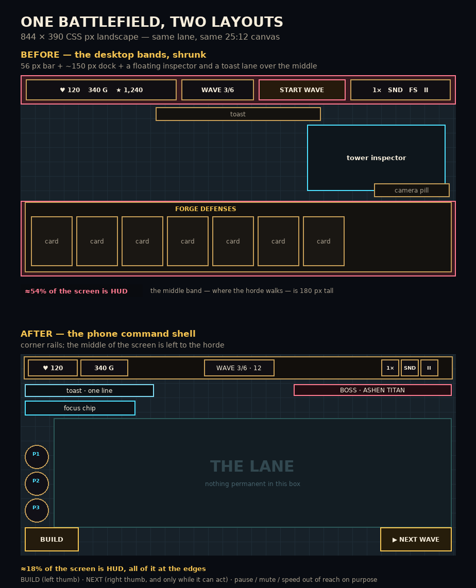

# The mobile command shell

_Why the game has two HUD layouts, what each one is for, and every rule that
decides what a phone player sees._

## 1. The problem with one layout

The game is locked to landscape, and its battlefield is 25:12 — on an 844 × 390
phone the canvas is 812 × 390, i.e. the whole height of the screen. That is
where the trouble starts, because the HUD is not inside the canvas: it floats
over it.

Before this work the phone inherited the desktop bands and merely shrank them:

| Band | Desktop height | On a 390 px-tall phone |
| --- | --- | --- |
| Top bar (`BASE` `GOLD` `SCORE`, wave badge, `START WAVE`, speed / mute / fullscreen / pause) | 56 px | 56 px |
| Forge dock (tab strip + seven cards + handle) | ≈ 150 px | ≈ 140 px |
| Floating inspector, anchored to the tower | 260 px tall | up to `46vh` over the lane |
| Toast lane, camera hint, camera pill, boss card, combo chip | floating | all over the middle |

That leaves roughly **180 px of clear lane on a 390 px screen** — and the part
that keeps getting covered (the middle) is exactly where the horde walks. The
complaint was not "the buttons are too small"; it was "the buttons are in the
way".

Shrinking further was not an option: touch targets bottom out at 44 px, so a
smaller dock means fewer controls, not smaller ones.



## 2. What the phone gets instead

The phone shell keeps the **corners** and gives the centre back.

```
┌──────────────────────────────────────────────────────────────┐
│ ♥120  ⛁ 340        WAVE 3/6 · 12        1×  🔊  ⏸            │  44 px rail
├──────────────────────────────────────────────────────────────┤
│ ⚡                                                            │
│ ⚡   ┌────────────────────────────────────────────────┐       │
│ ⚡   │                                                │       │
│     │            the lane, uncovered                 │       │
│     │                                                │       │
│ ⚒   └────────────────────────────────────────────────┘  ▶ NEXT│  46 px
└──────────────────────────────────────────────────────────────┘
  BUILD                                                    WAVE
 (left thumb)                                        (right thumb)
```

Nothing is permanent in the middle: no toast card, no combo chip, no camera
pill, no inspector until you ask for one. `▶ NEXT` is only on screen when it
can actually do something — while a wave is running it is `display: none`.

### Side-by-side

| | Desktop shell | Phone shell |
| --- | --- | --- |
| Top band | 56 px engraved bar, labelled stats, wave, `START WAVE`, 4 icon buttons | 44 px rail: base, gold, wave, speed / mute / pause |
| Score · map name · fullscreen · reset view | on screen | inside the pause card (`#pause-status`, `RESET VIEW`) |
| Forge | open card dock, ≈ 150 px | `⚒ BUILD` button (46 px) → full-width sheet on demand |
| Wave preview | hover popover over the lane | second line on the `▶ NEXT` button (`12 CREEPS · BOSS`) |
| Inspector | floating, draggable, anchored beside the tower | bottom sheet, `max-height: min(52vh, 250px)`, scrolls |
| Camera | zoom pill (+, −, fit) | pinch to zoom, drag to pan, `RESET VIEW` in pause |
| Toasts | parchment card, up to 620 px, top centre | one line, top left, ellipsis, 11 px |
| Boss | 460 px engraved card | 300 px slim strip, top right |
| Duel rival | wide strip | slim strip, same shoulder as the boss |
| Focus chip | top left | top left, under the rail |
| Kill-chain chip | under the bar | hidden (the score capsule owns the number) |
| Powers | bottom-left rail, above the dock | left edge above `BUILD`; hidden while the sheet is open |
| Placement hint | inside the dock | one-line pill, bottom centre, `✕` to cancel |
| Feedback | visual | visual + a 12 ms haptic tick |

## 3. The five rules it follows

The layout was not designed by taste. Five rules did most of the work, and they
are also the reasons the desktop shell was left alone.

1. **Thumb zone.** Primary actions live in the bottom corners; rare or
   destructive actions go where the thumb cannot reach by accident. That is why
   `BUILD` sits bottom-left, `NEXT` bottom-right, and pause / mute / speed are in
   the top rail. It is also why the inspector became a bottom sheet instead of
   following the tower: a panel beside a tower can land anywhere on the screen,
   including behind your hand.
2. **Occlusion.** A thumb covers the control it presses, so a pressed state
   under the finger is invisible. Feedback has to appear elsewhere: the haptic
   tick fires on press, the placement pill sits at the bottom centre, refusals
   shake the pill and buzz, and the wave composition is printed on the button
   rather than hovering above it.
3. **Earn every pixel.** Every persistent element is a tax. Score, map name,
   fullscreen and reset-view moved into the pause card because they are not
   needed while fighting. The combo chip was removed outright. `NEXT` deletes
   itself for the length of a wave.
4. **Context-adaptive.** The HUD should expand and collapse with what the player
   is doing. Opening the forge dims the map and turns the dock into a sheet;
   picking a card folds the sheet and leaves a one-line pill; opening a tower
   folds the same sheet; the scrim is the dismissal target. Nothing needs a
   dedicated close button.
5. **Stable anchoring.** Resting positions never move. The rail is always at the
   top and `BUILD` is always in the same corner, so muscle memory survives. Only
   presence and opacity animate in.

### What was considered and rejected

Two layouts is a decision, and the alternatives are worth recording so they do
not get re-proposed every sprint.

- **A radial build menu on the plot** (the Kingdom Rush pattern, and the usual
  advice for phone tower defence). It is the right answer for four tower types.
  It is the wrong answer for twelve defences across two families: twelve
  thumb-sized spokes cannot carry legible labels, and the roster already pages
  by family. The sheet keeps 44 px cards and a readable name and price.
- **Side rails outside the battlefield** (HUD pinned in 88 px columns left and
  right). Elegant, but our canvas is 25:12 and already fills the screen; rails
  would have to shrink the battlefield itself to make room, trading lane for
  chrome in a game whose whole problem was lane.
- **Shrinking the existing dock further.** Not available: 44 px is the floor for
  a touch target, so a smaller dock means fewer defences on screen, not smaller
  cards. The answer had to be "not on screen until asked for".
- **Auto-start the next wave** (a single toggle in most mobile TDs). Considered
  and left out of this sprint: it changes pacing and interacts with the
  early-call bonus, which is a gameplay change, not a layout one.
- **A draggable inspector on the phone.** Rejected on occlusion grounds: a panel
  anchored beside the tower can land behind the hand that opened it. A sheet at
  the bottom is predictable, capped and scrollable.

## 4. Interaction map (as it plays on a phone)

| Gesture | Result |
| --- | --- |
| Tap `⚒ BUILD` | forge sheet up, map dimmed |
| Tap a defence card | card armed, sheet folds, pill shows `PLACING … · tap a grass tile · ✕ to cancel` |
| Tap a valid plot | tower built, pill dismisses |
| Tap the dimmed map (sheet open) | sheet folds, nothing built |
| Tap a creep | focus fire: every tower in range prioritises it; tap again to release |
| Tap a tower | inspector sheet up, above the `BUILD` row |
| Tap `▶ NEXT` | start the next wave, or `CALL EARLY · +Ng` for the gold bonus |
| Drag / pinch | pan / zoom the battlefield |
| Tap a powerup | meteor arms a target, overcharge and fortify fire immediately |
| Tap `⏸` | pause card with `RESUME`, `RESET VIEW`, `BLESSINGS`, `CODEX`, `LEAVE BATTLE` |
| Tap `✕` on the inspector | close the sheet |
| Tap the focus chip | release the focus target (there is no Esc key) |

## 5. How the shell is chosen

`src/ui/shellMode.js` is pure and testable:

```js
resolveShell({ coarse, width, height, override })
// mobile  = coarse pointer AND landscape AND width <= 1100
// desktop = everything else
```

- A **narrow desktop window** keeps the desktop bands: it has a pointer, not a
  thumb, and its problem is not occlusion.
- A **portrait phone** is left to the rotate gate, which owns that screen on
  both shells.
- A **touchscreen laptop or wall display** has room for the bands.
- `?hud=mobile` and `?hud=desktop` override the guess, which is how the phone
  layout is reviewed from a desktop browser.

The result is written to `<html data-shell="mobile|desktop">`. Every rule in the
`MOBILE COMMAND SHELL` section of `src/style.css` is scoped to that attribute,
so the desktop layout cannot regress from phone work — and the phone layout
cannot half-apply.

`HUD.syncShell()` re-resolves on resize and rotation. Landing on the phone shell
folds the forge, drops a pinned inspector and hands the inspector box back to
CSS; landing on desktop restores the dock preference.

## 6. Files

| File | Role |
| --- | --- |
| `src/ui/shellMode.js` | `resolveShell`, `readShellOverride`, pref read/write, `applyShell` |
| `src/systems/Haptics.js` | vibration patterns, preference, graceful no-op on iOS |
| `src/ui/HUD.js` | shell detection, dock sheet, scrim, sheet inspector, pause status, placement copy |
| `src/style.css` | the whole `MOBILE COMMAND SHELL` block, plus the `.dock-scrim` base |
| `tests/mobile-shell.test.js` | 19 tests: detection, override, HUD behaviour, CSS contract |
| `tests/haptics.test.js` | 8 tests: preference, pattern length, unsupported platforms |

## 7. Checking it

```bash
npx vitest run tests/mobile-shell.test.js tests/haptics.test.js
npm run build
```

Then open `/?hud=mobile` in a desktop browser — the phone layout, at whatever
size the window is — or `/?hud=desktop` on a phone to compare.
