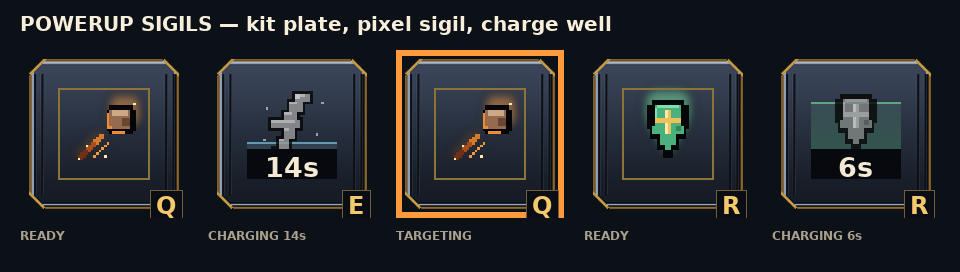

# Technical Documentation: Tower Defense (DSALGO Bastion Edition)

## 1. System Overview & Architecture

*Tower Defense: DSALGO Bastion Edition* is designed with a strict **Model-View separation** architecture:
- **Core Domain & DSA Layer (`src/dsa/`, `src/systems/`, `src/data/`):** Pure, platform-independent JavaScript classes with zero dependencies on Phaser or browser DOM. This design allows 100% headless testing in Node.js via Vitest.
- **Rendering & Engine Layer (`src/rendering/`, `src/entities/`, `src/scenes/`):** Phaser 3 scenes managing canvas rendering, sprite tweens, particle effects, and user pointer input.
- **Interface & Telemetry Layer (`src/ui/`, `src/style.css`):** Hardware-accelerated HTML5/CSS3 HUD and modal overlays displaying game state and live algorithm telemetry.

```
       +-------------------------------------------------------------+
       |                         USER INPUT                          |
       |                (Mouse Pointer, Hotkeys 1-7, C, L)           |
       +------------------------------+------------------------------+
                                      |
                                      v
       +-------------------------------------------------------------+
       |                         PHASER SCENES                       |
       |             (BootScene -> MenuScene -> GameScene)           |
       +------------------------------+------------------------------+
                                      |
                +---------------------+---------------------+
                |                                           |
                v                                           v
+-------------------------------+           +-------------------------------+
|       GAMEPLAY SYSTEMS        |           |       STUDENT DSA CORE        |
|  - EconomyManager             |           |  - Queue.js (Circular Buffer) |
|  - GameStateManager           |<--------->|  - Graph.js (Adjacency List)  |
|  - WaveManager                |           |  - BFS.js (Shortest Path)     |
|  - PlacementSystem (Hash Map) |           |  - MergeSort.js (Leaderboard) |
|  - PathfindingSystem          |           |  - LinearSearch.js            |
+---------------+---------------+           +---------------+---------------+
                |                                           |
                +---------------------+---------------------+
                                      |
                                      v
       +-------------------------------------------------------------+
       |                     UI & TELEMETRY DOM                      |
       |      (HUD Dock, Tower Inspector, Codex, Leaderboard)        |
       +-------------------------------------------------------------+
```

---

## 2. Battlefield Graph & Pathfinding System

### Map Representation
Every battlefield is compiled by `src/data/arenaLayout.js` (`buildArena`) and
exported from `src/data/mapData.js` as a $21 \times 12$ matrix of tiles (64×64
pixels each, total resolution $1344 \times 768$ px). The grammar is the same on
every map: the portal sits at the top of the field, the bastion at the bottom on
the same centre column, a rift crosses row 5 with two 2-wide bridges, and two
mirrored flank roads of 19 cells each run down to the gate.
- Road tiles (`#`), Spawn portal (`S`), and Base (`B`) are flagged as **walkable**.
- Grass (`.`) is buildable; road tiles are buildable too (free placement).
- Rock (`x`) and Water (`~`) are impassable barriers; the portal's landing ring
  and the bastion plaza are the only no-build zones (`systems/BuildZone.js`).

### Graph Construction
On initialization, `buildGridGraph()` scans the map grid and constructs an **undirected unweighted graph**:
- Each walkable tile $(r, c)$ is stored as a node identified by `"row,col"`.
- Orthogonally adjacent walkable neighbors (top, bottom, left, right) are connected via undirected edges.
- Total nodes: $V \approx 90$ walkable cells. Average degree: $d \le 4$.

### Barricade Placement on the Marched Route
The map contains **two mirrored routes** from the portal `(2,10)` to the bastion
`(8,10)` — one per bridge — of 19 cells each:
1. **Left lane:** down the west flank, across the left bridge, into the gate.
2. **Right lane:** down the east flank, across the right bridge, into the gate.

`laneIndexForWave(wave)` deals a whole wave down one lane and alternates, so a
wave never splits across both roads.

Every gate sits one tile inside the outer ring. The portal is a 96 px sprite and
the core platform 80 px, centred on a 64 px tile, so a gate parked on the last
tile has half its art outside the camera bounds — which is exactly how the spawn
and the core used to disappear into the edge of the screen. The tile of terrain
in front of each gate is the visible margin around the battlefield.
`tests/map-margin.test.js` re-derives the rule from the ASCII for the five
campaign maps and the three duel arenas.

BFS picks the middle route, so that is the lane the horde walks every time. The
graph is **never modified** by a palisade: a wall is a physical, damageable
object standing on a road cell, resolved by `Enemy.updateSiege()` (see
`docs/pseudocode.md` §4). Two rules keep the placement honest:

1. **On the road.** `PlacementSystem.validate()` requires `TILE.ROAD` and
   rejects the portal/base cells (`needs-road` / `endpoint`).
2. **On a marched route.** `GameScene` builds `routeCells` from
   `PathfindingSystem.laneCells` — the **union of every lane** — right after
   `computeLanes()` and hands it to the validator. A road cell that no wave ever
   walks is rejected with *"No enemies march through this tile"* (`off-route`)
   instead of silently eating the 30 gold.

Because the horde marches one lane per wave (`laneIndexForWave`), every legal
palisade stands on a road some wave will take, and an enemy that meets it stops
and swings — the wall can never be walked around. When the last hit lands,
`damageBarricade()` collapses it and the road reopens.

---

## 3. Custom Circular Buffer Queue

Wave enemy spawning and BFS frontier traversal require high-frequency First-In, First-Out (FIFO) operations.

```
Buffer Array [ _ , _ , EnemyA , EnemyB , EnemyC , _ , _ ]
                        ^                  ^
                       head               tail = (head + count) % capacity
```

### Invariant Properties
- `head`: Points to the front element.
- `count`: Number of active items.
- Tail insertion: Enqueues at `(head + count) % capacity` in $O(1)$ time.
- Head removal: Reads item at `head`, sets slot to `undefined` (preventing memory leaks), advances `head = (head + 1) % capacity` in $O(1)$ time.
- Geometric Resizing: When `count === capacity`, the internal buffer doubles in size ($2\times$) and unrolls elements into indices $0 \dots count-1$. This maintains **$O(1)$ amortized enqueue**.

---

## 4. Leaderboard Persistence & Merge Sort

High scores are persisted locally in `localStorage` under `td-dsalgo:leaderboard:v1`.

### Data Integrity & Crash Proofing
- If `localStorage` is disabled or corrupted, `src/utils/storage.js` creates a safety backup of corrupt data and provides an in-memory storage fallback.
- Individual records are verified with `normalizeRecord()`, discarding malformed entries without throwing runtime exceptions.

### Deterministic Multi-Level Tie-Breaking
When `getRanked()` is called, our student-written `mergeSort` sorts all records using `compareRecords`:
$$\text{Rank}(A, B) = \begin{cases}
B.\text{score} - A.\text{score} & \text{if } A.\text{score} \ne B.\text{score} \\
B.\text{waves} - A.\text{waves} & \text{if } A.\text{waves} \ne B.\text{waves} \\
A.\text{timeMs} - B.\text{timeMs} & \text{if } A.\text{timeMs} \ne B.\text{timeMs} \\
A.\text{timestamp} - B.\text{timestamp} & \text{if } A.\text{timestamp} \ne B.\text{timestamp} \\
A.\text{id} \leftrightarrow B.\text{id} & \text{lexicographical total order}
\end{cases}$$

---

## 5. Campaign, Level Data & Progression

`src/data/levelData.js` is the single source of truth for the campaign; the
scene never hard-codes "six waves" any more. Each level owns its battlefield,
theme, economy seed, core HP, enemy health scale, wave list, star thresholds,
boss and first-clear bounty.

| Level | Theme / map | Waves | Start gold | Core HP | Enemy HP scale | Boss |
|---|---|:-:|:-:|:-:|:-:|---|
| `level-1` Verdant Marches | grassland | 6 | 220 | 25 | 1.00× | Abyssal Warlord |
| `level-2` Sunscorch Mesa | desert | 7 | 240 | 25 | 1.15× | Dune Tyrant |
| `level-3` Frostbite Hollow | ice | 8 | 260 | 25 | 1.30× | Frost Warden |
| `level-4` Prism Depths | crystal | 9 | 280 | 25 | 1.45× | Prism Warden |
| `endless` Endless Siege | volcanic (The Convergence, 28×18) | ∞ | 320 | 25 | 1.20× + uncapped endless ramp | rotating every 5th wave, titans from wave 20 |

### Stars, rewards and unlocks (`src/systems/Progression.js`)
- **Star rating** — core HP kept: $\ge 85\%$ → 3★, $\ge 50\%$ → 2★, else 1★.
  Thresholds live on the level (`stars.two` / `stars.three`) so a future level
  can be stricter without touching the UI.
- **Rewards** — the first clear pays the level bounty and one extra gem for a
  3★; replays pay a 20% gold stipend and no gems.
- **Unlock graph** — a first clear unlocks `getNextLevel(id)`; the first win on
  `level-1` also opens `endless`. `ProgressStore` merges an older save over a
  fresh profile, keeps the best stars/score, and falls back to an in-memory
  store when `localStorage` throws (private mode, quota).
- **Endless** — `WaveManager` accepts `{ endless, waveFactory }`; wave *n* is
  generated on demand (5-wave cycle, boss on every 5th) and cached in
  `generated[]` instead of mutating the level definition. `totalWaves` reports
  `Infinity` and `isFinal` is never set, so the run can only end on a defeat.

### Endless difficulty (why it no longer plateaus)

Three separate caps used to collide: the campaign HP curve stops at 2× (wave
12), the generator stopped adding bodies at 18, and the boss rotation never
changed — so wave 20 was wave 5 with a longer queue. Each has its own fix:

| Dial | Function | Behaviour |
|---|---|---|
| health | `endlessHealthScale(w)` | $1 + 0.1w + 0.004w^2$ — **uncapped**: 2.2× at 10, 4.3× at 20, 15.5× at 50 |
| speed | `endlessSpeedScale(w)` | $\min(1.75, 1 + 0.012w + 0.00025w^2)$ — capped so the horde stays readable |
| bounty | `endlessRewardScale(w)` | $1 + 0.06w$ — a wave-40 grunt worth 7 gold could not fund the wall it breaks |
| boss health | `endlessBossHealthScale(w)` | $\min(3, 1 + 0.05w)$ — a titan already starts at 7 800 HP; the creep ramp would park a 90 000 HP timer on the lane instead of a fight |
| bodies | `makeEndlessWave(n)` | +3 bodies per cycle (cap 60) and a cadence multiplier of $\max(0.45, 1 - 0.012n)$ |
| bosses | `ENDLESS_TITANS` | `voidherald` joins from cycle 3 (wave 20), both titans from cycle 8 (wave 45) |

The scales are applied in `GameScene.spawnScaling(wave, typeKey)`, which is the
single place a spawn reads its multipliers from; campaign levels get exactly the
level definition and nothing else. Bosses are the one exception to the health
curve: `ENEMY_TYPES[typeKey].isBoss` routes them to `endlessBossHealthScale`, so
a titan stays a four-phase fight (3× at worst) while the escorting creeps keep
climbing without a ceiling. `tests/endless-difficulty.test.js` pins both curves.

### Victory / defeat flow
`GameScene.handleVictory()` → `ProgressStore.recordVictory()` → `ResultScreenUI`
(stars, rewards, one unlock line per door that opened, Next / Replay /
Leaderboard / Main Menu). `handleGameOver()` records the defeat (endless keeps
the depth reached, a campaign level keeps its saved best untouched) and shows
the same screen without stars. `window.gameFlow` in `src/main.js` owns the
transitions, so Next and Replay restart the battle with a new `levelId` rather
than stacking scenes.

`recordVictory()` reports `unlocked` (first door, kept for compatibility) and
`unlockedAll` (every door) because a single level-1 clear opens level 2 *and*
Endless Siege. `GameScene.init()` re-reads `levelId` from the resolved level, so
an unknown id can never be carried into a restart.

### Pause, codex and leaving a battle
`HUD.setPausedUI()` is the single owner of the paused state: it toggles the
pause card (`#pause-overlay`) and the passive chip used by gate pauses, and it
disarms the quit caution. The card holds RESUME, CODEX and LEAVE BATTLE —
the two controls that used to clutter the top bar. LEAVE BATTLE requires a
second tap within 4 s ("Leaving now discards this battle"); the confirmed call
goes to `window.gameFlow.quitToMap()`, which stops `GameScene` and reopens the
world map. Stars and rewards only come from a finished level, so an abandoned
run banks nothing.

### Screen layers
Campaign screens mount into `#screen-container` (z-index 250) and dialogs —
leaderboard, codex — into `#modal-container` (z-index 300). Both containers are
`pointer-events: none` so the battlefield keeps its drags, and each screen
re-enables pointer events on itself. Sharing one container used to let the
leaderboard's `innerHTML` write wipe the result screen it was opened from.

---

## 6. Game Balance & Economic Constants

Starting economy: **220 gold**, **25 base HP**, **70% sell refund** on `level-1`;
levels 2 and 3 start at 240 / 260 gold (see the campaign table above).
Wave-clear payout: $30 + 8w$ gold, $100w$ score.

| Tower | Cost | Range | Cooldown | Damage | Special Capability |
|---|:---:|:---:|:---:|:---:|---|
| **Ballista (archer)** | 🪙 60 | 155 px | 0.62 s | 16 | Balanced single-target; L2 (🪙50) → Rapid Ranger (🪙90) / Sniper (🪙100) |
| **Boulder Sling (cannon)** | 🪙 110 | 150 px | 1.65 s | 55 | 70 px splash with distance falloff; L2 (🪙85) → Siege Sling (🪙135) / Stone Hammer (🪙150) |
| **Frost Bastion** | 🪙 85 | 140 px | 0.95 s | 10 | 40% slow for 1.6 s; L2 (🪙65) → Blizzard (🪙110) / Lightning (🪙120) |
| **Hammerforge** | 🪙 120 | 140 px | 1.60 s | 60 | Explosive slam (66 px); L2 (🪙85) → Emberforge (🪙130, 92 px blast, crowds) / Thunderforge (🪙140, 72 px blast, 35% pen) |
| **Runestone** | 🪙 135 | 170 px | 1.10 s | 30 | Magic bolts (75% armour bypass); L2 (🪙95) → Void Lance (🪙130, true damage) / Arcane Nova (🪙140, splash) |
| **Banner Keep** | 🪙 125 | 155 px | 1.25 s | 16 | Aura: +15% damage, +6% range within 150 px; L2 (🪙85) → Great Warbanner (🪙115, damage) / Muster Camp (🪙120, fire rate + gold per kill) |
| **Palisade** | 🪙 30 | N/A | N/A | N/A | 420 HP wall on the road — enemies must break it; L2 (🪙35) → 900 HP + 20 thorns/s |
| **Iron Crossbow** | 🪙 70 | 175 px | 0.95 s | 34 | Piercing bolts (20% pen); L2 (🪙60) → Repeater (🪙105, 4.3/s, crowds) / Siege Arbalest (🪙115, 65% pen, +25% boss) |
| **Clockwork Repeater** | 🪙 125 | 118 px | 0.15 s | 8 | Shortest range, highest sustained DPS; L2 (🪙95) → Storm (🪙130, 11/s, crowds) / Shredder (🪙135, −30 armour per burst, plate) |
| **Pitchfire Siphon** | 🪙 95 | 105 px | 0.90 s | 18 | 34 px cone + burn DoT; L2 (🪙75) → Inferno (🪙115, single target) / Napalm Mortar (🪙120, 110 px pool, crowds) |
| **Venom Still** | 🪙 105 | 165 px | 1.10 s | 16 | Poison DoT that ignores armour; L2 (🪙85) → Plague Vat (🪙120, spreads) / Corrosive Still (🪙125, −30 armour, plate) |
| **Harpoon Winch** | 🪙 115 | 200 px | 2.20 s | 75 | 150 ms stun, 30% pen; L2 (🪙90) → Siege Harpoon (🪙145, +50% boss) / Grapple Winch (🪙140, 700 ms stun + slow) |

Every branch declares **one job** — crowds, single target, armour, bosses, control
or support — and the numbers are held to it by `tests/branch-niche.test.js`. The
full effective-damage tables (and the method behind them) are generated into
[`balance.md`](balance.md) by `node scripts/balance-report.mjs`.

### The five-tier ladder (`src/data/towerAscension.js`)

Every line upgrades **1 → 2 → branch (3) → 4 → 5** — all twenty-one of them,
the ten royal lines included (Request 45). The shop tiers stay in
`towerData.js` (and `royalDefences.js` for the royal roster); the two tiers above
the branch live in `towerAscension.js` and are merged over the specialisation
they belong to, so a tier only declares what it changes.

A *support* branch (the repair yard, the field engineer, the two obelisks) deals
no damage at all, so `dps()` is 0 for every tier of it. Anything that asks "is
this upgrade worth it?" or "is this worth its gold?" has to score those branches
on the field they hand the roster instead — `tests/helpers/balance.js`
(`supportPower`, `fieldPower`) is the one place that does, and the tests import
it rather than inventing a private weighting.

| Line / branch | L3 DPS | L4 DPS (cost) | L5 DPS (cost) | Capstone signature |
| --- | ---: | ---: | ---: | --- |
| archer · rapid | 109 | 254 (🪙170) | 450 (🪙300) | 3-shot **Arrow Storm** |
| archer · sniper | 115 | 235 (🪙180) | 452 (🪙320) | 2-shot, 80% pen **Twin Lance** |
| cannon · siege | 115 | 197 (🪙190) | 352 (🪙340) | 2-shell **Twin Bombard**, 128 px blast |
| cannon · artillery | 130 | 179 (🪙200) | 311 (🪙360) | 560-hit **Titanfall**, −40 armour |
| frost · blizzard | 31 | 47 (🪙175) | 73 (🪙330) | **Frost Nova**: every hit detonates 96 px |
| frost · lightning | 66 | 105 (🪙185) | 169 (🪙340) | 6-target **Chain Storm** |
| forge · ember | 111 | 164 (🪙190) | 338 (🪙350) | 2-slam **Eruption**, −34 armour |
| forge · thunder | 82 | 121 (🪙195) | 185 (🪙355) | 118 px **Skyfall**, 60% pen |
| runes · void | 61 | 100 (🪙185) | 231 (🪙345) | 2-lance **Twin Oblivion** |
| runes · nova | 52 | 88 (🪙180) | 209 (🪙340) | 2-rune **Rune Split**, 96 px |
| banner · warbanner | 26 | 36 (🪙165) | 51 (🪙320) | +55% dmg / +24% range aura |
| banner · muster | 21 | 29 (🪙130) | 42 (🪙240) | +28% fire rate, +3 gold per kill |

The ladder is deliberately **not** flat in DPS: a capstone is 2.0–4.1× its
branch, and the multiplier is carried by a named behaviour (`ability.shots`,
`ability.nova`) rather than by a bigger number. The ten royal lines have their
own two-branch tables in [`royal-defences.md`](royal-defences.md) §2 (branch A)
and §2b (branch B).

**How the roster is priced.** Raw DPS is the wrong yardstick once splash, DoT,
chain, control and support exist: a 60 DPS venom still kills a pack that a 300
DPS crossbow cannot, and a repair yard kills nothing at all. Every branch is
therefore scored on what it actually does, against four representative targets
(`pack`, `single`, `armor`, `boss`) in `tests/helpers/balance.js`:

- damage branches are `dps × mitigation`, plus burn, splash, chain and trap
  terms that mirror the runtime rather than a hand-picked multiplier;
- support branches (banners, workshops, obelisks) are scored by `supportPower`:
  the fire rate, range, repairs, ward and gold-per-kill they hand the field,
  scaled by the area they cover;
- the resulting figure is divided by the gold to max the branch.

The bands that fall out of that model are asserted, not written down here:

- power per gold inside the **damage** family stays within **4.2×**, the
  **control** family within **2.5×** and the **support** family within **1.5×**;
- the cheapest and the dearest maxed tower are within **1.9×** of each other;
- every branch still clears **1.6×** its level-3 output at the cap, so no
  upgrade is a downgrade;
- every branch beats its sibling by **8 %** on the column its niche promises.

`tests/engineer-defenses.test.js` recomputes the bands from the data, so a
future balance edit that breaks them fails CI instead of shipping;
`tests/branch-niche.test.js` does the same for the niche contract, and
`node scripts/balance-report.mjs > docs/balance.md` prints the same numbers as
Markdown.

### Damage over time, stuns and enemy traits

Five mechanics arrived with the engineer lines. All of them live on the entity,
not in the scene, so they are unit-testable headlessly:

| Mechanic | Where | Rule |
| --- | --- | --- |
| Burn / poison DoT | `Enemy.applyDot` + `updateDots` | ticks `dot.damage` every `tickMs` for `durationMs` as **true** damage (armour is skipped), one stack per `kind` — re-applying refreshes instead of duplicating |
| Stun | `Enemy.applyStun` | freezes movement, scaled by the target's `stunResist` (bosses 0.4–0.7, capped at 90%) |
| Boss bonus | `Projectile.hitEnemy` | `bossBonus` multiplies the hit only when `enemy.isBoss` |
| Phalanx | `Enemy.applyDamage` | creeps packed with allies take 15–22% less, so splash is the answer |
| Adaptive plate | `Enemy.applyDamage` | +2…3 armour per hit up to a cap, so armour break and true damage earn their slot |
| Enrage | `Enemy.enrageMultiplier` | up to +30…45% speed at 1 HP, so a wounded runner still has to be finished |

`Projectile.hitEnemy` is the single funnel for splash, single-target and chain
hits, which is why a napalm shell applies its burn to everything in the pool
exactly once. `Tower.fire` reads `shots`,
`Projectile.impact` reads `nova`, and the HUD inspector prints the ability name
under `SIGNATURE` — so a new tower gets the system for free.

Tier 4/5 base textures are generated (`build_tower_ascension()`): the branch
art is re-graded through the line's element ramp, rim-lit, and at level 5 given
a power ring on the plinth. Geometry is inherited, so pivots and muzzle offsets
stay calibrated; `TOWER_VISUALS` expands `SLOTS` to eight per line.

**A re-grade alone was not enough.** Players read a palette shift as "the same
tower, warmer", so every tier above 1 also *grows parts*. `Tower` owns two extra
containers (`decorBack`, `decorFront`) rebuilt by `refreshDecorations()` on each
upgrade, from generated art in `scripts/build_tower_decor.py`:

| Tier | Added geometry | Runtime behaviour |
| --- | --- | --- |
| 1 | — | plain keep |
| 2 | merlon crown + two pennants | pennants swing on a sine tween |
| 3 | fortified footing + hung battle standard | crown widens 6%, pennants ride outwards |
| 4 | twin braziers with flame | flame textures cycle every 120 ms + scale pulse |
| 5 | two shards above the keep | shards bob and tilt in opposite phase |

The tiers are cumulative, so the part count strictly increases (0 → 3 → 5 → 9 →
11): a maxed tower is a different building, not a different tint. New parts
spring in (`Back.easeOut`) when the upgrade lands.

Projectiles get the same treatment: `src/data/projectileArt.js` maps each line
to its own level-4/5 shot, and `Tower.projectileArt` prefers it. The Banner Keep
now fires a golden `proj-banner` instead of borrowing the archer's arrow.

### Testing a defence by fighting with it

`tests/helpers/combat.js` runs the real `Tower.update` → `Projectile.update` →
`Enemy.update` loop against a stubbed Phaser scene. The stub answers every
display-object call with itself, so nothing about the game logic is faked: the
entities are the production classes, and only the renderer is replaced. A line
that never fires, a shot with a missing texture, a DoT that never reaches
`applyDot` or a muzzle offset that points backwards shows up as "the creep
walked the lane untouched" rather than as a bug report.

`tests/engineer-battle.test.js` uses it to pin the claims a player would notice:
each of the five lines kills a grunt on the first third of the lane, the
crossbow opens fire ~57 px earlier than the repeater, the siphon leaves a
burning stack, the still's poison ticks straight through armour 40, the harpoon
stuns, an apex tower needs fewer shots than its level 1, and a level-5 upgrade
in the middle of a fight does not break the next shot.

### Focus fire (`src/systems/FocusTarget.js`)

Each defence has a targeting mode — first, last, strongest, nearest — and every
mode is a *rule*: set once in the inspector and then left alone for the rest of
the run. Rules cannot answer the question a player asks in the middle of wave 9:
why is nobody killing the healer? A shaman that walks behind a crowd, a summoner
that keeps replacing the creeps, or a boss about to reach the core all need to
be singled out by hand.

The mark is that hand. Tap a creep on the battlefield and every tower that can
reach it fires at it first; tap it again, press `Esc`, or tap the chip under the
top bar to release. The rule is implemented in `Tower.acquireTarget()`, *after*
the range filter and *before* the targeting-mode switch:

```js
const marked = this.context.focusTarget ?? this.scene?.focusTarget;
if (marked && !marked.isDead && !marked.reachedBase && (marked.health ?? 1) > 0) {
  // …if the mark is in `inRange`, it becomes currentTarget and we return
}
```

Four properties make it safe:

- **It never disables a defence.** If the mark is not in range, or is dead, the
  tower falls through to its own mode in the same call. Scene-side,
  `updateFocusFire()` prunes the mark right after the enemy list is compacted,
  so a corpse releases it in the same frame.
- **It is not a stat.** The mark changes *who* takes the damage, never how much,
  so `docs/balance.md`, the niche contract and the power-per-gold bands are all
  untouched. It raises the skill ceiling instead of the numbers.
- **Hit-testing is nearest-wins** (`enemyAt`, radius 30 px, world space). In a
  swarm the player taps the creep they can see on top, not the first element of
  the array.
- **Building and inspecting win the tap.** An armed dock card still builds, and
  a defence under the cursor is still inspected; the focus branch only runs on
  an empty tile with no build armed, so nothing that worked before needs a new
  gesture.

The reticle is four corner brackets and one thin ring around the creep, not a
filled shape: the lane is already full of fire, shockwaves and damage numbers,
and a second full-screen effect would be noise. `docs` note in §8.3 applies —
pulses stay under ~1.6 s and the brackets are 2 px, so the mark reads without
strobing. The HUD chip under the top bar reports the name and health of the
marked creep (and doubles as the way out for touch devices with no Esc key).

`tests/focus-target.test.js` (12 tests) covers hit-testing, the toggle, the
override of a targeting mode, the fallback when the mark is out of range or dead,
and the chip.

### Reading a defence at a glance

The inspector reports **DPS** next to damage, range and cooldown, because the
roster cannot be compared on damage alone: an 8-damage repeater out-damages a
75-damage harpoon. The figure is `damage × ability.shots / cooldown` (so a
capstone's extra volley is included), and a DoT line adds its tick rate as a
quieter `+N burn` / `+N poison` suffix — the rate the shot keeps dealing while
the target stays lit, not a guess at uptime.

### The specialisation chooser

At level 2 the inspector has to sell one of two futures, and it used to show two
stacked buttons: a name, a price and a paragraph. Nothing on that panel showed
the tower being bought or what it would do differently, so the branches read as
interchangeable and the choice felt like a menu item.

Each branch is now a card (`HUD.specCard`) that carries:

- **the building itself** — `TOWER_VISUALS[typeKey][spec-a | spec-b]`, the same
  art the tower will use on the board;
- a **lane** (`PATH I` gold, `PATH II` cyan) so the pair is legible as a choice;
- a **role** derived from the stats, not from copy: `HUD.describeRole()` reads
  aura → burn/poison → boss bonus → armour break → splash → chain → stun/slow →
  pierce → fire rate → range. A "CONTROL" badge cannot survive a patch that
  removes the stun, and the Siege Harpoon is filed under BOSS HUNTER rather than
  CONTROL even though it also stuns;
- **before → after chips** for DPS, rate and range, priced with the same
  `dps()` the balance suite uses, so the preview and the tower cannot disagree;
- the cost as a call to action, and the whole card as the button — the player can
  tap anywhere on the tower they want.

`tests/spec-ui.test.js` pins all five, including that every card's art file
exists and that the two branches never show the same sprite. On narrow screens
the pair stacks into one column (≤ 520 px) and the pitch clamps to three lines,
with the full text still in the card's tooltip.

### Powerups (`src/systems/Powerups.js`)

Three hand-played tricks with independent cooldowns, on `Q` / `E` / `R` (the
rail sits above the dock, left edge — outside the dock so `--dock-clearance`
never has to grow):

| Powerup | Effect | Cooldown |
| --- | --- | --- |
| Meteor Strike | 520 explosive damage in a 120 px crater, 45% falloff at the rim | 26 s |
| Overcharge | every tower fires 70% faster for 7 s (`cooldownScale 0.59`) | 34 s |
| Fortify | repairs every palisade and restores 40 core integrity | 42 s |

Clearing a wave refunds 8 s of every cooldown, and the state machine is pure
(no Phaser, no DOM) so the rules are unit tested. `Tower.attackCooldown`
multiplies in `powerups.cooldownScale`, which is how one button reaches every
defence on the map.

**The sigils.** The rail shipped as three perfect circles with a radial
gradient, a font emoji (`☄` `⚡` `✚`) and a conic sweep. Three problems with
that: an emoji is a different picture on every platform, a circle with a radial
glow is the stock mobile-game button, and a rotating pie is a timer, not a
charge. They are now the same object as the rest of the HUD:

- the plate is the kit's `btn_square` 9-sliced at 10 px, so the chamfer and the
  bronze rim come from the same generator as the dock cards and the pause card;
- the picture is a 64 px pixel sigil from `scripts/build_ui_kit.py`
  (`glyph_meteor`, `glyph_overcharge`, `glyph_fortify`), drawn on the same
  32-unit grid and with the same ink outline as the menu glyphs;
- the cooldown is a **well** that fills from the bottom of the socket
  (`--charge`, 0 → 1) instead of a pie sweep, with a countdown strip that only
  exists while there is something to count;
- ready is a single gold hairline inside the frame plus one 900 ms flash when
  the cooldown ends — not a permanent glow, because three buttons breathing
  forever is the eye-strain the effect pass bans.

`tests/powerup-rail.test.js` pins the DOM and the flash; the look is pinned as a
stylesheet contract in `tests/mobile-shell.test.js`.



| Enemy | Base HP | Speed | Siege | Reward | Score | Role |
|---|:---:|:---:|:---:|:---:|:---:|---|
| **Goblin Grunt** | 75 | 62 px/s | 10 | 🪙 7 | 10 pts | Standard foot soldier |
| **Shadow Runner** | 40 | 125 px/s | 6 | 🪙 6 | 12 pts | Agile sprinter |
| **Iron Brute** | 320 | 38 px/s | 34 | 🪙 22 | 35 pts | Heavy armored juggernaut (3 base damage) |
| **Stone Colossus** | 1250 | 34 px/s | 55 | 🪙 100 | 250 pts | Wave 3 mid-boss, 2 phases |
| **Abyssal Warlord** | 3300 | 32 px/s | 70 | 🪙 200 | 600 pts | `level-1` final boss, 3 phases |
| **Dune Tyrant** (`sandwyrm`) | 2600 | 46 px/s | 60 | 🪙 180 | 500 pts | `level-2` boss: Sandstorm Aura (+35% speed, 190 px) every 7 s; Razor Winds below 45% HP |
| **Frost Warden** (`frostwarden`) | 3600 | 28 px/s | 75 | 🪙 220 | 600 pts | `level-3` boss: freezes towers in 170 px, shields itself below 55%, immune to slow below 22% |
| **Magma Regent** (`magmalord`) | 4200 | 30 px/s | 85 | 🪙 260 | 700 pts | Endless boss: summons swarms, hastes the horde, then burns immune to slow |
| **Void Herald** (`voidherald`) | 7800 | 30 px/s | 160 | 🪙 460 | 1700 pts | Endless titan: 4 phases — tower lockout → summoned brutes → collapse → hasted Event Horizon |
| **Obsidian Behemoth** (`obsidian`) | 9000 | 26 px/s | 140 | 🪙 420 | 1500 pts | Endless titan: 4 phases — 70 armour + shield escorts → 1500 HP skin → fracture haste → unstoppable |

Boss abilities are dispatched from one shared `abilityTimer` in
`Enemy.update()` (`summon` / `speedAura` / `disableTowers`); `GameScene`
answers them with `handleBossSpeedAura()` (haste pulse + toast + shake) and
`handleBossDisableTowers()` (freeze pulse, tower tint, refreshed auras).

Wave Health Scaling: $\text{HP}(w) = \text{BaseHP} \times \min(2, 1 + 0.09 \times (w - 1))$
for the campaign, multiplied by `endlessHealthScale(w)` in Endless (see §6.2).

---

## 7. Battlefield & Horde Art Pipeline

The battlefield and the horde are generated, not hand-painted per map, so adding
a fifth biome is a palette entry rather than a second art pack.

### 7.1 Procedural terrain (`scripts/terrain.py`)
`build_ground`, `build_road`, `build_water`, `build_rock`, `build_decor` and
`build_foliage` each paint a 64×64 RGBA tile (32×32 for the scatter props) from
the theme's ramp. `build_spire_assets.py` only writes the files and the manifest.
Two properties matter for correctness:

- **Determinism.** Every random draw comes from `random.Random(seed_for(...))`
  with a `zlib.crc32` seed — Python's `hash()` is randomised per process, which
  would churn every PNG (and the git diff) on each build.
- **Compositing, not painting.** `road_*` and `water_*` leave every pixel outside
  their fringe fully transparent. `GameScene.renderBattlefieldMap()` paints
  ground, then lane/water, then decor/rocks, so a lane edge can never disagree
  with the biome ground beside it. The earlier version painted ground colour into
  the fringe, which forced a per-neighbour recomputation and produced bluish seams
  on the ice map; `_fringe()` also wrapped its out-of-bounds probes (`x % size`),
  which painted a false rim on every seam between two connected tiles. Both are
  fixed at the source.

Each biome also owns one landmark prop (`build_foliage`): Spire oak, saguaro,
snow-laden fir, charred deadwood, crystal prism cluster. A recoloured tree was tried first and read as
"the same tree, tinted", which is exactly what the map pass was meant to remove.

Crossings are their own art. `terrain.build_bridge(theme)` draws a one-tile
deck — rung planks, two timber parapets with posts, dressed-stone sills and a
shadow cast onto the water — from the biome's own road and rock ramps, and
`scripts/build_bridges.py` writes `bridge{suffix}.png` for all twelve biomes.
The renderer puts it on any lane cell that has water on both sides, rotated a
quarter turn when the water runs north-south, so a crossing is never a squashed
road tile.

Duel arenas do not borrow those tilesets: `scripts/build_arena_tiles.py` writes
a full 42-tile set per arena theme (`-caldera`, `-glacier`, `-oasis`) from the
same palette tables, including a themed landmark (`_build_obsidian`,
`_build_serac`, `_build_palm`). Hordes re-use a biome regrade through
`ENEMY_THEME_ALIAS`, because an ember brood on black basalt reads better than a
fourth set of sprites nobody can tell apart.

### 7.2 Surface readability audit
`surface_contrast(theme, 'road' | 'water')` returns a YCbCr distance between a
surface and its biome ground, weighted 55/30/10/5 % across the ramp because the
bright foam stop only covers a rim. `python3 scripts/terrain.py --contrast`
prints the table; `tests/terrain-contrast.test.js` enforces a floor of 26 and
fails if two biomes share a lane or water value. Current values (road / water):
grassland 58.0 / 41.7, desert 43.9 / 77.9, ice 37.9 / 61.9, volcanic 36.2 / 73.8,
crystal 61.0 / 34.7.

### 7.2b The roster, and where the bodies come from

Twenty archetypes ship today: six campaign creeps, three Flare creeps, eight
bosses and the two endless titans. `ENEMY_SOURCES` in the generator maps each
creep to a source strip; `BOSS_SOURCES` does the same for bosses and adds a
grade. Both accept a path relative to `src/assets` (`flare/enemies/thrall`), so a
second art pack does not have to be copied into the Spire folder.

The Flare side is imported once by `scripts/extract_flare_enemies.py`: it reads
the pack's per-frame rectangle/offset definitions, lifts the front-facing
direction, removes the baked shadow (the game draws its own, and a baked one
would rotate with the body), and recomposites idle/move/death into the same
9-row strip. Empty tail columns are blank rather than repeated keyframes, so the
manifest's measured frame counts stay honest.

Facing is a property of the source art, not of the game: the Spire strips are
top-down and rotate to their heading, while the Flare six are upright
three-quarter views and declare `facing: 'camera'`, which mirrors instead of
rotating. Sprite size comes from the measured ink box — averaged over the idle
and move rows for the Flare sheets, whose poses swing too widely for frame 0 to
represent them.

Rotation: `ENDLESS_BOSSES` keeps the campaign five first and appends
`ironhorn`, `ashwing` and `gravesworn`, so early endless is unchanged and the
new bosses appear from cycle 5 (wave 30). The three new creeps join endless from
cycle 2 onward and appear in the later campaign stages.

### 7.3 Horde skins (`src/systems/EnemySkins.js`)
Three pure lookups, all exported for the tests:

| Axis | Function | Effect |
|---|---|---|
| battlefield | `textureFor(type, theme, tier)` | `ENEMY_SKINS` maps each creep to a baked sheet per biome |
| escalation | `tierForWave(wave)` | waves 1–2 base, 3–4 elite, 5+ champion, then capped |
| colour | `paletteForWave(wave)` | rows 0–2 / 3–5 / 6–8 of the strip, in two-wave blocks |

The generator bakes **45 creep sheets** (8 creeps × 5 battlefields × 3 tiers).
Tier 1 adds saturation and a gold contour; tier 2 lays an ember ramp under the
biome hue and grows an ember contour one pixel outwards, so the champion's
*silhouette* is bigger, not just warmer. `Enemy` multiplies its base scale by
`ENEMY_TIERS[tier].scale`, adds an additive brood glow ellipse from tier 1 up, and
stakes a ground ring under champions so a wave tier reads even at a glance.
Bosses are excluded on purpose and keep their single duotone sheet.

**Facing rule.** Every strip is top-down art, but each creature is drawn with
its head somewhere specific inside the frame: on the **bottom edge** for eight of
the nine creeps and both titans (mandibles, claws, eyes at the bottom), on the
**top edge** for the void butterfly. The manifest therefore carries a `facing`
field per sheet — `south`, `north`, or `camera` for front-on art that must never
rotate — and `Enemy.faceTravel(dx, dy)` derives its rotation offset from it:

```js
rotation = snap45(atan2(dy, dx) + FACING_OFFSET[sheet.facing])  // south: −90°, north: +90°
```

History matters here, because the bug shipped twice. The first pass used one
blanket `+90°` offset on art that points *down*, which is 180° out: every creep
walked with its back to the camera, and a horizontal lane showed a full profile.
The second pass "fixed" it by pinning `rotation = 0` everywhere, which only made
the error consistent — the horde always faced south. The per-sheet contract
replaces both. Rotations snap to 45° steps so pixel art stays legible, the flip
flag is cleared whenever the body is turned (mirroring a rotated sprite swaps the
head to the tail side), and the palisade siege path uses the same call with the
vector to the wall. `tests/enemy-facing.test.js` walks a four-leg lap — south,
east, north, west — and asserts the quarter turn lands on the frame the lane
changes, for a south-drawn sheet and for the north-drawn butterfly.

`scripts/build_spire_assets.py --manifest-only` re-derives every measurement and
the `facing` table straight from the shipped PNGs without re-encoding a single
texture, which is how the manifest stays generated rather than hand-edited.

### 7.4 One battlefield, four biomes (`MAP_BIOMES`)

The endless battlefield is the only map in the game whose ground changes
underfoot. `MAPS.volcanic` holds the 28×18 ASCII layout; `MAP_BIOMES.volcanic`
holds a grid of the same shape, one letter per cell:

```
i  ice      d  desert      v  volcanic      c  crystal
```

`getMapBiomes(mapId)` decodes it to theme ids (or returns `null`, which is the
campaign case — those maps are one biome each and fall back to the level theme).
`GameScene.renderBattlefieldMap()` then resolves every texture through
`tileTexture(base, themeId)`, so one cell of `tile-road-13` becomes
`tile-road-13-ice`, `-desert`, `-volcanic` or `-crystal` depending on where it
sits. A malformed grid is ignored rather than thrown: a texture falling back to
the level theme is cosmetic, a crash mid-wave is not.

Two details sell the effect:

- **Water keeps one colour per body.** Every water cell in the meltwater river is
  tagged `i`, so the river does not change palette when it crosses the snow→dune
  seam. The oasis is `d`, the caldera lake `v`.
- **The road is one material.** Lanes are always painted from the level theme,
  not the cell's biome: a crystal causeway turning lavender mid-run read as a
  rendering bug, and a consistent stone road is what makes a 54-cell path easy to
  follow across four palettes.

Seams between biomes carry a terrace lip — a 7 px shadow on the south edge of the
cell that steps down, a 3 px highlight on the north edge of the cell below — so
the transition reads as ground falling away instead of a ruler line. A dither
blend of the neighbouring ground was tried first and rejected: a full-tile alpha
overlay reads as a grid of squares, not as a gradient.

Lane squares with water on opposite sides are **bridges**: the water is painted
first, then the road as a 60 %-depth deck with two timber rails, so the river
visibly continues underneath.

### 7.4b Five buildings, not one keep (`scripts/build_engineer_towers.py`)

The engineer roster shipped with five lines built from one generator function.
It gave each line its own pennant colour and its own roof mount, and — because
every tier only scaled the same drawing up — five identical grey keeps that
grew to 118 px wide and collided with their own upgrade badges. The five names
were the only thing telling them apart.

The generator now derives each line's canvas from its own proportions
(`PROPORTIONS`, `geometry()`), and each line owns a builder:

| Line | Building | Reads as, at 64 px |
|---|---|---|
| Iron Crossbow | tall arbalest tower | a full-width prod, a V-string on a brass nut, a loaded bolt |
| Clockwork Repeater | squat iron bunker | a flat riveted roof, a six-mouth drum, a smokestack, meshed cogs |
| Pitchfire Siphon | round fuel boiler | a domed copper tank, a chimney with a fire mouth, a lit firebox grate |
| Venom Still | alchemist's works | a glass flask half full of distillate, a neck, a condenser coil, a drip tap |
| Harpoon Winch | dockyard crane | a king post and a horizontal jib, a pulley and hook, a rope reel |

Tiers add *structure* — a second winch, a bigger drum, a priming tank, a second
flask, more string planes — so an upgrade changes the silhouette. The base is
mounted on the same brick shaft, because that shaft is the family resemblance;
everything above it is the line.

Three consequences worth keeping:

- **Footprints are capped.** The art is 42–72 px wide and 80–129 px tall, against
  60–118 × 94–152 before. `tests/engineer-art-distinct.test.js` fails above
  72 × 130, which is the range where a 64 px tile starts overlapping its
  neighbours' badges.
- **`mount` is measured, not guessed.** It is `shaft + 11` from each drawing's
  own ground line, so the weapon pivot sits on the deck at ~47 % of the art's
  height for every line and tier. The old table hard-coded `height - 30` and
  drifted the moment a canvas changed.
- **The dock card is a crop of the crown, not a shrunk tower.** At 64 px the
  signature is all there is room for: prod, drum, chimney, flask, crane. The
  previous card scaled the whole 118 px keep down to 40 px, which is how five
  different buildings became five grey slivers.

Sprites are compared in the tests by alpha channel, anchored bottom-centre on
the shared ground line (`silhouetteDifferenceAnchored` in `tests/helpers/png.js`).
Recolours cannot pass: the pair-wise crown difference is 0.22–0.65, and every
upgrade moves at least a quarter of the crown's ink. The five lines also carry
their own tier-4 and tier-5 projectiles (`scripts/build_projectiles.py`), so the
last two upgrades are visible in flight as well as on the building.

### 7.5 Adding a look
1. Add or edit a ramp in `terrain.py` (`RAMPS` / `ROAD_RAMPS` / `WATER_RAMPS`).
2. Add a landmark in `build_foliage` if the biome needs one.
3. Add the ASCII layout to `mapData.js`, then point a level at it.
4. `python3 scripts/build_spire_assets.py && npx vitest run`.

The manifest (`src/data/spireManifest.js`) is generated; never edit it by hand.

---

## 7.5 Mirror Arena: duel mode

PvP is a **race over an identical script**, not a shared simulation.

```
GameScene ──reportSeat/reportProgress──► PvpRoom ──intent──► host LobbyState
     ▲                                     │                      │
     └──────── launch payload ─────────────┴────── snapshot ◄─────┘
```

- **Data** (`src/data/pvpArenas.js`): three 26 × 16 layouts, each generated as a
  180° rotation pair with gates inset at `(7,1)` and `(8,24)`, plus one 10-wave script
  (mid-boss on wave 4, arena boss on wave 8). `getPvpLevel()` returns a level
  object with the same shape the campaign uses, so `GameScene` needs no second
  code path.
- **Rules** (`src/systems/PvpMatch.js`): a pure state machine — seats, readiness,
  and the resolution ladder knockout → points → core HP → clear time → draw.
  `resolve(match)` is the single authority; it runs on the host and in tests.
- **Room** (`src/net/LobbyState.js`, `src/net/PvpRoom.js`): the host folds client
  intents into a reducer and broadcasts a snapshot; challengers adopt it. The
  only state on the wire is `{roomCode, arenaId, seed, status, clients, seats}`.
- **Transport** (`src/net/transports.js`): the only path that can cross a device
  boundary is `WebSocketTransport`, which dials `/pvp` on whatever host served
  the page; `BroadcastTransport` is kept for two tabs of one browser and for
  tests. `preferredMode()` decides which, in this order:

  | Where the game came from | Default link |
  | --- | --- |
  | `http(s)://` — dev server, preview URL, any host | ONLINE relay → same-origin `/pvp` |
  | `file://` — opened straight from disk | THIS BROWSER |
  | `VITE_PVP_RELAY=ws://…` at build time | ONLINE relay → that URL |
  | `?pvp=local` / `?pvp=relay` in the URL | forces one for that tab |

  The lobby exposes the choice as two chips on the entry screen and remembers it
  in `localStorage['td-duel-link']`, so a room is never silently local.
- **Which relay** (`src/net/relayAddress.js`): first match wins — the lobby's
  saved RELAY ADDRESS → `?relay=` → `VITE_PVP_RELAY` → the same origin's `/pvp`.
  `normaliseRelayUrl()` turns `https://…`, a bare host or `host:port` into a
  `ws(s)://` URL and defaults the path to `/pvp`, so what a player pastes cannot
  become a socket that never opens. This is the escape hatch for **static
  deploys**: Vercel/Pages/S3 cannot hold a WebSocket open, so the relay has to
  live elsewhere (`render.yaml` is a one-click blueprint) and the address is
  supplied at runtime — no rebuild.
- **The relay** (`server/pvp-relay.mjs`) forwards envelopes and knows nothing
  about the rules. `vite.config.js` proxies `/pvp` for **both** `npm run dev` and
  `npm run preview`, so the relay is reachable on the page's own origin — that is
  what lets two phones share a room with no configuration. A static host such as
  Vercel has no relay process: build with `VITE_PVP_RELAY=wss://relay.example/pvp`
  to point the client at one you host.

### 7.5b The handshake, and why a join can no longer fail silently

```
client → hello  {roomCode, name, host}
relay  → note   {state:'waiting'}      guest arrived before the host
relay  → welcome{seat:'p1'|'p2'}       seated — the dial is done
relay  → bye    {reason} then close    bad-code | code-taken | full | no-room | no-host
```

- `WebSocketTransport.connect()` resolves on `welcome`, *not* on socket `open`. A
  refused room rejects with a sentence from `linkError(reason)` and the lobby
  prints it under the entry grid — the panel stays exactly where it was.
- A guest that taps JOIN **before** the host has created the room is held for
  15 s (`PVP_PENDING_MS`) and seated the instant the code appears. Two phones no
  longer have to tap in the right order.
- Seats are reclaimed by client id, so a host that reloads re-attaches to its own
  room instead of being told the code is taken; a dead slot never blocks a code.
- Broadcast rooms cannot be acked by a server, so `PvpRoom` watches for a silent
  peer: a joiner that hears no snapshot for `PEER_TIMEOUT_MS` (9 s) is told that
  local rooms never leave the browser. That silent wait *was* the two-device bug.
- Dial retries are bounded (400 / 900 / 1800 ms) and a relay that never answers
  fails with instructions instead of hanging. A link lost **after** seating is
  reported as `LINK LOST`, never silently redialled into a different room.
- The relay's `bye` frame is flushed before the socket closes (`send` callback),
  because a bare `close()` can drop the very frame that explains the refusal.
- A host's arena pick goes through the same local-intent path as every other
  action. It used to apply to the host's state and publish only to the host's
  own view, so the challenger's board kept the old arena until some unrelated
  broadcast happened to fire. `tests/pvp-sync.test.js` fails if that returns.

### 7.5c How live is the duel, measured

Two seats trade tiny snapshots over one socket. There is no polling, no tick
reconciliation and no shared simulation — each seat runs the same deterministic
script from the same seed, so the horde is identical by construction (the only
`Math.random()` on the battlefield is a cosmetic idle wobble).

| What | How it is kept | Measured (localhost relay) |
| --- | --- | --- |
| Lobby change (ready, arena, start) | intent → host reducer → snapshot to both seats | arrives with the next message, no debounce |
| Rival strip (wave / points / core HP) | 2 Hz heartbeat, unchanged ticks dropped | guest→host **p50 0.28 ms / p95 0.73 ms** · host→guest **0.25 / 0.31 ms** |
| Countdown | host owns the deadline, each seat rebuilds it from `countdownRemaining` on its own clock | both seats within **≤ 1 ms** of each other (median 1.0 ms over 10 runs, 3.2 s countdown); a phone 4 minutes off still starts on time |
| Snapshot size | `{roomCode, arenaId, seed, status, clients, seats}` | **586 B** mid-match (≈ 137 KiB/min at 2 Hz both seats) |
| Cost of adopting one | pure object maths, no DOM | **2.4 µs** per `adoptSnapshot` + `lobbyView` |
| Rival strip repaint | budget in `src/systems/DuelTelemetry.js` | **≤ 9 paints/s** instead of 60, and 2 sends/s |
| Wave schedule (duel) | host-free: each seat runs the same clock off its own simulation | `PREPARE 10 s` → wave → `NEXT WAVE 5 s` → wave … |
| End of match | first knockout resolves in the reducer, both seats pause and paint the card | same beat, no waiting state |
| Leaving the card | `gameFlow.stopDuelScene()` stops the scene, keeps the room | no paused board behind a live HUD |

The last row is the one that matters on a phone: `GameScene.syncDuelTelemetry()`
runs on the frame loop, and reading `room.view` allocates the whole lobby view
while a style write per frame forces layout. Both now sit behind
`telemetryPlan()`, and `HUD.setRivalState` additionally bails out when nothing it
shows has moved — a duplicate heartbeat costs no message, no allocation and no
DOM write.


- **Fairness:** relics, blessings and profile writes are skipped when
  `level.pvp` is true (`GameScene.trackStats`, `syncAchievements`, and the
  victory/defeat handlers), so duels cannot farm campaign progress.
- **Camera:** `CameraRig` bounds are now map pixels, and `fitZoom()` derives a
  per-map minimum zoom (1× campaign, 0.75× arena, hard floor 0.45×), so a duel
  can pull back to the whole battlefield to watch the rival lane.

## 8. Addictiveness Systems

Three layers, built in that order: **dopamine** (moment-to-moment), **retention**
(reasons to come back) and **economy** (something to spend it on). This section
covers the first layer; the later layers extend it without changing its rules.

### 8.1 Kill chains (`src/systems/ComboMeter.js`)

A pure state machine — it never owns a timer, the caller passes `nowMs` — so the
windowing rules are testable without a scene.

| Kill chain | Tier | Payout multiplier |
|---|:---:|:---:|
| 0–2 | 0 | 1× |
| 3–5 | 1 | 1.25× |
| 6–9 | 2 | 1.5× |
| 10+ | 3 | 2× |

Kills must land within **2.6 s** of the previous one. The bonus is *additive*:
`comboBonus(base, mult)` returns only the extra gold/score, rounded, so a kill
can never pay less than its listed bounty. A leak (an enemy reaching the core)
or the end of a wave resets the live chain; `resetCombo` keeps the wave's best
chain so the end-of-wave payout still pays out. A cleared wave pays
`min(90, (best − 2) × 4)` gold for the best chain, and a chain that long also
raises the HUD chip to its ember tier.

Because chains reward *tempo*, the chain also fights the player's instinct to
hoard: you must keep killing, which means standing waves down rather than
letting them trickle in.

### 8.2 Early wave call (`src/systems/WaveManager.js`)

The wave button has two states. In the prep phase it reads **START WAVE**. While
the last stragglers of a wave are still walking (`clearing`, zero pending spawns,
`aliveEnemies > 0`) it becomes **CALL EARLY · +Ng** and starts the next wave *on
top of the leftovers* for `min(70, 6 + 3 × alive)` gold.

The guard rails matter more than the payout:

- **Only in `clearing`.** The spawn queue is per-wave; calling early mid-spawn
  would silently drop the pending spawns of the wave being replaced. `#beginWave`
  clears the queue on purpose, so the state check is the safety, not a courtesy.
- **Never on the final wave** of a fixed campaign (there is no next wave), but
  always available in Endless.
- **The settled wave still counts.** `callEarly()` increments `wavesCompleted`
  and pays that wave's clear bounty immediately; the leftovers keep the new wave
  alive, which is exactly the risk being bought.
- The chain payout for the settled wave is paid at the call site, because that
  wave will never emit `waveComplete`.

### 8.3 Feedback (the juice pass)

| Moment | Feedback |
|---|---|
| Kill | tint flash (`Enemy.applyDamage`), biome/brood-tinted spark burst + additive flash ring, bigger with chain tier |
| 3 / 6 / 10 kills | `audio.playCombo(tier)` triangle stinger, pitch climbing `523.25 × 1.2^(tier−1)` |
| Early call | `audio.playCallEarly()` square sweep 392 → 587 Hz, toast with the payout, camera-warm pulse on the button |
| Boss spawn | letterbox bars close in and out, camera kick + warm flash |
| Wave clear | payout toast that names the best chain when it paid |
| Every shot | muzzle flash in the tower's element, sparks thrown along the barrel |
| Every hit | 9-frame elemental burst + falling debris + smoke puff; splash adds a ground shockwave and a camera kick |
| Frost capstone | 96 px ice nova with crystal shards |
| Upgrade | gold ring + glyph burst over the keep; level 5 leaves a breathing aura ring |
| Powerup | meteor: ground blast + 12 ms screen shake + orange flash; overcharge: cyan flash on every tower |

All effects are fire-and-forget and wrapped in `try/catch` through
`reportRuntimeError`, so a missing texture or tween can never freeze the
simulation loop.

### 8.4 HUD additions

- **Wave preview**: a scout strip under the wave button during the prep phase
  listing the next wave's composition and flagging a boss. It is absolutely
  positioned so the top bar never reflows, and it sits below the toast lane.
- **Combo chip**: multiplier, chain length, last bonus and a draining timer bar.
  It takes priority over the preview strip — mid-fight the chain is the number
  the player is chasing.
- The wave button itself carries the early-call bonus, so the decision is priced
  on the control that makes it.

### 8.5 The boss strip is a roster, not a slot

Endless can put more than one boss on the lane: cycle 3 sends a titan beside the
anchor boss and cycle 8 sends both titans with it. The panel is a single strip,
so `GameScene` no longer keeps one `activeBoss` pointer — it keeps a
`BossTracker` (`src/systems/BossTracker.js`) and asks it who owns the strip.

- **Who wins the strip.** Highest total pool (`maxHealth + maxShield`), ties to
  the earlier spawn. The titan outranks the anchor it arrived with, and a phase
  shield counts, so a shielded boss cannot lose the bar to a smaller one.
- **A death never blanks the panel.** `onBossDefeated`, a leak and the per-frame
  prune all route through `syncBossPanel()`, which hands the strip to the next
  live boss (and re-reads its name and phase) or hides it when the lane is clear.
  The old single slot hid the bar while an anchor was still walking behind the
  dead titan.
- **Untracked phase changes are ignored.** A phase shift on a boss that does not
  own the strip can no longer print its phase onto another boss's name.
- **The strip stays one strip.** `#boss-extra` shows `+N BOSSES` when the roster
  is deeper than the panel, so the player knows the bar is not the whole story
  and the panel never grows tall enough to cover the lane on a phone.

---

## 9. Retention Layer

The second layer answers "why come back tomorrow?" — a date-seeded daily run,
a checklist that pays gems, and depth markers for the mode that has no ending.

### 9.1 Daily Challenge (`src/systems/DailyChallenge.js`)

One run per local calendar day, identical for every player:

- `dayKey(date)` → `YYYY-MM-DD` (local, so the reset happens at the player's
  midnight, not UTC's).
- `seedForDay(key)` → FNV-1a hash; `mulberry32(seed)` is the PRNG. The same day
  therefore produces the same modifier and the same level, and a refresh cannot
  reroll the challenge.
- `dailyRun({ date, unlockedIds })` picks one of six modifiers and one level the
  player has actually unlocked (Endless is excluded — it has no finish line).
- `applyDailyModifiers(level, modifier, key)` returns a copy with the twist
  applied, so the campaign data is never mutated.

| Modifier | Twist | Gems |
|---|---|:---:|
| Standard Muster | no twist | 3 |
| Midas Rush | +40 starting gold, horde +15% HP | 4 |
| Glass Bastion | core 15 HP, +60 gold | 5 |
| Lean Rations | 140 starting gold, kills pay +25% | 4 |
| Siege Day | horde +30% HP, +80 gold | 6 |
| Bounty Board | kills pay +40%, horde +10% HP | 4 |

`DailyStore` owns the streak. Starting the run is enough to keep it alive; the
win pays the modifier's gems exactly once per day. `currentStreak()` treats
yesterday's run as still alive until midnight (so the menu is not scary at
00:05), and a gap of two or more days resets the visible streak while
`bestStreak` is kept.

### 9.2 Achievements (`src/data/achievements.js`, `src/systems/Achievements.js`)

24 entries across combat / defense / campaign / endurance / daily, worth
**96 gems** in total. Each entry is data — `{ metric, target, gems }` against
the lifetime stats in `ProfileStore.profile.stats` — so one evaluator covers
all of them and the menu can render real progress bars ("612 / 1000 kills").

`ProgressStore` folds gameplay into those stats:

| Hook | Stats |
|---|---|
| kill | `kills`, `goldEarned`, `bestChain` (peak), `bossesKilled` |
| early call | `earlyCalls` |
| build | `towersBuilt` / `palisadesBuilt`, `maxTowersAtOnce` (peak) |
| upgrade | `upgradesBought` |
| wave clear | `wavesCleared` |
| victory | `victories`, `threeStarVictories`, `flawlessVictories`, `starsTotal` |
| endless record | `endlessBestWave` (peak) |
| daily win | `dailyWins`, `dailyStreak` (peak) |

Peak metrics use `trackStats(patch, { max: [...] })` so a 20-kill chain is a
record, not 20 more kills. `syncAchievements()` pays every newly satisfied entry
once and saves; the scene calls it on wave and run boundaries so a fight is not
interrupted by a toast storm.

### 9.3 Endless checkpoints (`src/systems/EndlessMilestones.js`)

Checkpoints every 5 waves to 50, then every 10 to 100, paying `30 + 6·wave` gold
and 1–5 gems. `milestonesBetween(lastPaid, wave)` makes the payout idempotent, so
an early call or a replayed wave cannot double-pay. The HUD shows the personal
best under the wave number in Endless and flips to `NEW BEST · N` the moment the
run passes it — `isRecordWave()` is the single comparison behind that.

### 9.4 Surfaces

| Surface | Change |
|---|---|
| Main menu | `DAILY CHALLENGE` button: today's modifier, streak flame, "cleared" state |
| Achievements overlay | grouped checklist with per-entry progress bars and gems |
| HUD wave badge | `BEST N` / `NEW BEST · N` in Endless |
| Result screen | daily modifier + streak + gems row, achievement names for the run |

---

## 10. Economy Layer

Two currencies, two jobs. **Gems** buy permanent relics (meta-progression);
**gold** buys in-run power and towers. Keeping them apart means a bad run still
pays forward, and a whale cannot buy a wave.

### 10.1 Relics (`src/data/relics.js`, `src/systems/Relics.js`)

Six relics, **73 gems** to own outright, 14 levels total:

| Relic | Levels | Effect | Gem costs |
|---|:---:|---|---|
| War Chest | 3 | +50 starting gold / level | 3 / 5 / 7 |
| Reinforced Core | 2 | +5 core HP / level | 4 / 6 |
| Sharpened Blades | 3 | +8% tower damage / level | 4 / 6 / 9 |
| Swift Hands | 2 | −6% tower cooldown / level | 5 / 8 |
| Gilded Kills | 2 | +10% kill gold / level | 3 / 5 |
| Second Wind | 2 | +8% sell refund / level | 3 / 5 |

`relicBonuses(profile.relics)` returns **factors**, not percentages, so callers
multiply instead of remembering what "8%" means:

```js
{ startingGold: 100, baseHealth: 5, damage: 1.16, cooldown: 0.88,
  killGold: 1.1, sellRefund: 1.08 }
```

`GameScene.init()` reads the collection once, then `create()` folds it into the
starting economy and the core's maximum HP. Damage and cooldown are applied in
`refreshTowerAuras()` after the Banner Keep auras, so a relic never fights a
buff and the cooldown multiplier is floored at 0.4 (a tower can never stall).

`buyRelic()` is pure: it returns the next map + the gem cost and never mutates
the save. The Forge UI banks the gems and persists, which keeps the purchase
rules in one tested place.

### 10.2 Run blessings (`src/systems/Blessings.js`)

Gold sinks *inside* a battle, bought from the pause card so the player is never
distracted mid-wave:

| Blessing | Cost | Effect | Per run |
|---|:---:|---|:---:|
| Wrath | 120g | +20% tower damage | 1 |
| Plenty | 100g | +15% kill gold | 1 |
| Mending | 150g | +5 core HP (capped at max) | 2 |
| Haste | 110g | −8% tower cooldown | 2 |

`blessingBonuses(purchased)` stacks repeated purchases, `canBuyBlessing()` is the
single affordability/cap check, and `GameStateManager.healBase()` refuses to heal
a finished match or overshoot the maximum. Purchases recompute tower auras
immediately, so Wrath applies to the next shot rather than the next wave.

### 10.3 Surfaces

| Surface | Change |
|---|---|
| Main menu | `THE FORGE` opens the relic shop |
| Forge overlay | one card per relic: pips for owned levels, current → next effect, price, MASTERED state |
| Pause card | `BLESSINGS` opens the in-battle gold sink (paused, so no lost wave) |
| HUD | relic and blessing multipliers are invisible by design — they read as bigger numbers, not new numbers |

---

## 11. Interface Kit & Menu Architecture

Full write-up: [interface-kit.md](interface-kit.md).

The skin the game shipped with was a free demo pack (warm wood plates, five icons) laid
over cold pixel-art battles, and every ink token was tuned for those light plates. Once
the same copy sat on the dark campaign overlays it was dark-on-dark — the achievement
rows, forge "Next: +50 starting gold" line and blessing descriptions were unreadable on
screen. The third UI pass replaces the art instead of recolouring it.

### 11.1 Generated, deterministic art

`scripts/build_ui_kit.py` (Pillow) bakes 28 sprites into `public/assets/ui-kit/` at the
**exact canvas sizes and 9-slice geometry the stylesheet already used**, so the swap
changed no layout:

| Family | Canvas | Slice |
|---|---|---|
| `frame_panel` / `frame_panel_soft` / `frame_panel_inset` | 281×292 | 50 / 30 / 40 35 |
| `frame_note` | 1090×330 | 30 |
| `frame_bar` | 1511×384 | 40 60 |
| `btn_iron` / `btn_gold` / `btn_crimson` / `btn_ghost` | 377×160 | 28 50 |
| `btn_square` | 152×160 | 24 |
| `card_iron` / `card_crimson` | 281×343, 281×342 | 35 30 |
| `slot` / `slot_sel` | 137×148, 138×148 | 20 |
| `glyph_*` | 64×64 | — |
| `cursor` / `cursor_click` | 32×32 | — |
| `fx_ring` / `fx_glow` | 128×128 | — |

No RNG: a rebuild is byte-identical. The menu key art (`menu-keep.jpg`) and the ashlar
wall behind the action column (`menu-stone.jpg`) are painted assets committed once; they
sit behind layered scrims so the plates stay the brightest objects on screen. The
cinematic plaques (`plaque_gold/steel/crimson/dark`, `plate_tile`, `chip_metal`) and the
seven new marks (`keep`, `warroom`, `quill`, `star`, `gem`, `flame`, `skull`) are
generated by the same script. See `docs/interface-kit.md` §8.

Because the geometry never changed, **the swap was a token rename**: the 34 `--cozy-*`
usages became `--ui-*` URLs, and no `border-image-slice` or `border-image-width` value
moved.

### 11.2 Tokens

All plates are dark, so `--ink-*` flipped to light values (the single exception is
`--ink-on-gold`, for the gold primary plate). `--wood`, `--parchment`, `--slate`,
`--teal` and `--crimson-surface` survive as *measured surface* tokens that the contrast
script references — they no longer describe wood or parchment.

### 11.3 The contrast audit is coupled to the art

`scripts/check-contrast.mjs` compares `:root` ink tokens against `SURFACES`, which are
the **measured average fills printed by the generator**. After a palette change you rerun
the generator and paste the new numbers; otherwise the audit would keep passing against
art that is no longer on screen. Current state: 47/47 pairs ≥ 4.5:1 (worst is
`--text-dim` on the dark page at 6.0:1; body copy on the panel plate is 15.6:1).

### 11.4 Menu architecture

The menu was a 520 px single column of nine equal buttons inside a scrolling card: on a
landscape phone the inner scrollbar clipped the title, and no action read as "start
here". It is now a two-column card:

- **Brand column** — wordmark, gold rule, one line of flavour, and a save summary
  (`STARS / GEMS / MEDALS`, painted by `refreshMenuSummary()`), plus the controls hint.
- **Action column** — `PLAY` as the only gold plate (the one light surface, dark ink),
  the daily challenge directly under it (modifier name + streak), then a 3×2 tile hub for
  Forge, Achievements, Champions, Codex, How to Play and Credits. Fullscreen is demoted
  to a small pill.

Nothing scrolls on a 360 px-tall landscape viewport; `max-height: 430px` hides the
flavour text and summary instead of shrinking touch targets, and `max-width: 620px`
collapses to one centred column. The ids `src/main.js` binds are unchanged.

### 11.5 In-play surfaces

Top bar and dock use `frame_bar`; stat chips, sockets and the name input use `slot`
(gold rim when selected); build cards use `card_iron`; the boss banner uses
`card_crimson`; toasts and the result summary use `frame_note`; buttons use `btn_*`.

New: `GameScene.shockwave()` pops a `fx_ring` sprite (tier-3 kills, boss entrance, boss
death) and the boss entrance adds a centred halo. Both are guarded on
`textures.exists('fx-ring')`, so a missing kit costs a flourish, never a fight.

### 11.6 Guard rails

`tests/ui-kit.test.js` (40 tests) asserts that every asset URL in the stylesheet and the
markup resolves, that each sliced sprite keeps its exact canvas size and leaves a
stretchable middle, that every `menu-*` id `main.js` binds exists exactly once, that the
old scrolling button column is gone, and that the retired demo pack is not referenced by
the CSS, the markup or the contrast audit.

## 12. Two shells: desktop and phone

The HUD used to be one layout that shrank at breakpoints. That works until the
screen is 390 px tall in landscape: the desktop bands (a 56 px top bar, a
~150 px card dock, a floating inspector anchored to the tower) leave about
180 px of clear lane, and the parts of the screen that get covered — the top,
the bottom, whichever side the selected tower is on — are the parts where the
horde walks.

So the HUD now has two layouts and picks one at start-up. The full design note,
with the layout map, the five rules it follows and the interaction table, is in
[`docs/mobile-shell.md`](mobile-shell.md). This section is the engineering
summary.

### 12.1 Choosing a shell (`src/ui/shellMode.js`)

```js
resolveShell({ coarse, width, height, override })
// mobile  = coarse pointer AND landscape AND width <= 1100
// desktop = a fine pointer, a portrait screen, or a touchscreen with room
```

The function is pure, so the whole matrix is unit-tested without a browser.
`?hud=mobile` / `?hud=desktop` override the guess for review, and the outcome is
written to `<html data-shell="…">`:

```js
applyShell(document, hud.shell); // before the markup is built
```

Every phone rule in the stylesheet is scoped to that attribute
(`[data-shell="mobile"] …`). That is deliberate: the desktop layout cannot
regress from phone work, and the phone layout cannot half-apply. `HUD.syncShell()`
re-resolves on resize and rotation; landing on the phone shell folds the forge,
drops a pinned inspector and returns the inspector box to CSS.

### 12.2 What changed in the HUD (`src/ui/HUD.js`)

| Behaviour | Desktop | Phone |
| --- | --- | --- |
| Start of battle | dock per saved preference | always folded to `⚒ BUILD` |
| Picking a card | dock stays open | sheet folds, pill carries the name |
| Expanding the forge | — | `#dock-scrim` dims the map; a tap anywhere on it folds |
| Inspector | `placeInspector()` writes inline geometry | `repositionInspector()` returns early and clears inline styles |
| Inspector drag | pointer drag on the header | disabled — a CSS sheet cannot be dragged |
| Wave preview | popover on hover | second line on the `▶ NEXT` button |
| Score / map / fullscreen / reset view | top bar and camera pill | `#pause-status` and `RESET VIEW` in the pause card |
| Placement copy | “click a grass tile · ESC to cancel” | “tap a grass tile · ✕ to cancel” |
| Toasts | parchment card | one-line ticker + a haptic pattern per type |

The `▶ NEXT` button is the clearest example of the phone rule "a control only
exists while it can act". It keeps its DOM parent, its handler and its aria
attributes, but on the phone it is `position: fixed` in the bottom-right thumb
corner and `:disabled` hides it — so the button is absent for the entire
duration of a wave and returns between waves.

### 12.3 Touch feedback (`src/systems/Haptics.js`)

`navigator.vibrate` with short, named patterns (`tap` 12 ms, `build`, `upgrade`,
`deny`, `wave`, `boss`) so a thumb that is covering the control still gets a
confirmation. One delegated `pointerdown` listener on `#hud-container` covers
every control, including ones added later. Enabled by default only on a coarse
pointer, stored under `td-dsalgo:haptics:v1`, and a silent no-op where the
platform (iOS Safari) does not expose the API.

### 12.4 Scrolling inside a `touch-action: none` HUD

`#hud-container` declares `touch-action: none` so drags reach the camera. Every
scrollable panel inside it must hand its own axis back or it cannot be swiped:

```css
[data-shell="mobile"] .hud-dock:not(.collapsed) .dock-cards { touch-action: pan-x; }
[data-shell="mobile"] .inspector-body { touch-action: pan-y; }
```

### 12.5 Guard rails

`tests/mobile-shell.test.js` (19) pins the detection matrix, the override, the
fold-on-pick behaviour, the scrim, the CSS-owned inspector sheet, the pause
status and the layout rules themselves (rail height, hidden camera pill, sheet
geometry, single-line toasts). `tests/haptics.test.js` (8) pins the preference,
the pattern lengths and the unsupported-platform path. Existing HUD suites
(dom, hit area, responsive) were not modified and still pass, which is the
evidence that the desktop shell is unchanged.

## 13. The Vanguard, its ranks and the companions

The Vanguard used to be one painted pose, one button and a leash nobody pulled:
it walked only where it was told, so a player who did not want to micromanage
never used it. The redesign answers that with three ideas, all data-driven.

### 13.1 Ranks (`src/data/heroData.js`)

| Rank | Sheet | Health | Damage | Swing | Strike | Skills |
|---|--:|--:|--:|--:|--:|---|
| 1 Vanguard | `hero-vanguard` | 500 | 30 | 1000 ms | 100 / r75 / 12 s | Shieldbreaker |
| 2 Captain | `hero-captain` | 640 | 38 | 900 ms | 130 / r88 / 10.5 s | + War Cry |
| 3 Warlord | `hero-warlord` | 820 | 48 | 820 ms | 170 / r104 / 9.5 s | + Bulwark |

Every rank is a **different sheet** (Tiny Swords blue → yellow → red warrior) drawn
at its own height (86 / 92 / 98 world px measured from the body box), so a
promotion changes the silhouette on the board as well as the numbers. Rank 1 is
the old stat line unchanged, which keeps the balance pass meaningful.

Ranks are bought **between battles**, in the Muster Hall, with banked gold
(160, then 300). `ProgressStore.heroRank` stores the ladder and clamps a
hand-edited save into 1–3.

### 13.2 Autopilot and skills

`HERO_AUTO` is the leash: `aggro 300`, `leash 360`, `retargetMs 220`,
`standoff 0.62`, `manualHoldMs 6000`. Each frame the hero re-decides: the
nearest ground creep inside its post's aggro ring → walk to a standoff point →
swing on its own cadence; no target → walk home to `post`. A manual move order
suspends the autopilot for six seconds and then hands it back, so the MOVE button
is an override, never a requirement.

Skills cast themselves when their `auto` trigger is satisfied:

| Skill | Trigger | Effect | Cooldown |
|---|---|---|--:|
| Shieldbreaker | ≥2 creeps in `strike.radius` | rank-dependent area damage | 9.5–12 s |
| War Cry | ≥2 creeps in 190 px | 35 % slow for 4 s | 15 s |
| Bulwark | health ≤ 35 % | heal 35 %, 50 % damage reduction for 4.5 s | 20 s |

`Hero.update()` returns `{ moved, attacked, casts }`; the scene turns `casts`
into one VFX per cast (a burst + a frost nova for War Cry, a nova for Bulwark).
The HUD gets the same skills as buttons, so a player who wants to hold a cooldown
in reserve still can.

### 13.3 The death read

The pack ships no death row for the knights, so dying is communicated the way the
rest of the game already does it: the sprite drops to 45 % alpha and greys, the
`fx-skull` sheet plays a single 14-frame puff above the body, and the HUD flags
`DOWN`. It returns at full health when the next wave starts.

### 13.4 Companions (`src/data/petData.js`, `src/entities/Pet.js`)

Five bought companions, each one ability, none of them able to touch the lane:

| Id | Name | Sheet | Price | Ability |
|---|---|---|--:|---|
| `bramble` | Bramble | Pawn | 150 | taunt: 40 damage + 35 % slow |
| `wool` | Wool | Sheep | 240 | mend: heals 16 % of the Vanguard |
| `fletch` | Fletch | Archer | 340 | shot: 45 damage at 240 px |
| `ember` | Ember | Torch Goblin | 460 | burn: DOT through `Enemy.applyDot` |
| `boomer` | Boomer | TNT Goblin | 620 | bomb: 90 damage in 80 px |

A companion follows the hero at `+62 / +34` px, snaps when left 360 px behind, and
is **not targetable and not a collision body** — it can be added or removed
without moving a single enemy. Its clips are the same idle / walk / attack rows
as the hero's, driven by `data/unitArt.js`.

### 13.5 Where it is bought

`ProgressStore` grew three fields next to `relics`: `pets` (owned ids), `pet`
(the equipped one) and `heroRank`. Both are validated on load — unknown ids are
dropped, an unowned equipped pet is cleared, the rank is clamped — so an old or
tampered save cannot invent a companion.

The shop is `src/ui/PetShopUI.js`, opened from **MUSTER HALL** in the world map's
top bar (`#wm-pets`). It is deliberately *not* in the battle HUD: gold spent in a
run buys towers, gold banked between runs buys the roster, and the two wallets
can never be confused for one another.

## 14. The gate rule: what happens when the line breaks

The bastion is not a doorway. A creep that reaches it does not walk inside and
vanish — it stops on a **ring** around the keep and lays siege
(`Enemy.updateBaseAssault`, `systems/BarricadeCombat.js` → `assaultRing`):

* the ring radius is `ASSAULT_RANGE = 72` px, and each attacker takes the slot
  on the **bearing it arrived on**, inside an `ASSAULT_FAN` of 80°, so a horde
  surrounds the gate from the side it broke through instead of overlapping one
  pixel and never crossing the keep;
* a swing costs `assaultDamage(def) = round(baseDamage / 3)` of the core, once
  every `assaultInterval(def)` (1.5 s / 1.7 s / 2 s by weight), through the one
  door base damage is allowed to pass: `GameScene.handleEnemyHitBase`.

That ring lives inside the **no-build moat** (`BuildZone`, `BASE_CLEARANCE = 1`
tile), which is exactly where the player may not raise a defence. On a 64 px
grid the closest legal tower centre is 128 px from the keep, while the ring is
72 px from it — so an attacker on the far side of the keep stands up to ~200 px
away, further than every weapon's range in the game. The line goes silent with
the towers intact and the core bleeds out: the reported bug.

### 14.1 The rule

`Tower.acquireTarget` measures range to the creep, with one exception:

> A defence whose own range reaches the **bastion** answers the creeps that are
> **hitting the bastion**, wherever on the ring they stand.

Implementation: both tower construction sites (`attemptBuild`, `placePreplacedTowers`)
put `getBasePoint: () => this.bastionPoint()` on the tower context — the same
closure `spawnEnemy` already hands the creeps, so the art, the hitbox and the
range check cannot disagree. `acquireTarget` computes `coversBastion` once per
frame, then accepts an out-of-range creep only when
`coversBastion && enemy.assaulting === true`.

What the rule deliberately does **not** do:

* it does not widen a weapon's range generally — a defence that cannot see the
  gate still ignores the fight at the gate, and a creep crossing the courtyard
  is only a target inside the normal range;
* it does not bypass `canEngage`, so the ground / air rule, the live BOTH /
  GROUND / AIR filter and `supportOnly` all still apply — a cannon never
  acquires a flyer, a banner still never shoots;
* it does not change damage, cadence or the core's hit points.

### 14.2 The clock

`Tower.update` now clamps the cooldown instead of leaving it negative:
`cooldownTimer = max(0, cooldownTimer - deltaMs)`. Before, a frame longer than
the time left on the timer parked it at a permanent `-30` (visible on every idle
tower in the probes, and in the inspector), where it looked exactly like a
broken clock. Firing behaviour is unchanged — a non-positive timer is already
"ready" — but the state is now honest.

### 14.3 Regression

`tests/gate-coverage.test.js` runs the real `Tower` and the real `Enemy` over
the stub scene from `tests/helpers/combat.js`: a west tower acquires an
east-slot attacker that is beyond its own range but inside its gate coverage;
the same creep walking past is ignored; a tower four tiles up the lane is
unaffected; a ground gun still refuses a flyer; and a real projectile lands
damage on the ring attacker.

## 15. Who gets attacked: defences first, the gate last

Two rules decide what a ground creep fights, and both live in
`systems/BarricadeCombat.js` so the entity and the scene cannot disagree.

### 15.1 Reach

```text
huntRadiusFor(attacker, bastion)
  toBase = distance(attacker, bastion)
  return toBase <= GATE_GUARD_RADIUS ? GATE_GUARD_RADIUS : DEFENCE_HUNT_RADIUS
```

* `DEFENCE_HUNT_RADIUS = 80` px (1.25 tiles) out on the road — a keep hugging
  the lane is in the way, a keep two tiles out in the field is not.
* `GATE_GUARD_RADIUS = 192` px (3 tiles) inside the ring that guards the
  bastion: whatever the player raised to hold the gate is a target before the
  gate itself.

`pickDefenceInReach` then takes the nearest standing structure in that radius;
a palisade wins a near-tie because it is the thing physically blocking the road.
Ruined and destroyed structures are skipped.

### 15.2 Order

`Enemy.update` step 5 is now *defences*, step 5b is *the bastion*:

```text
guard <- getStructureAhead() or getDefenceInReach()
if guard and updateSiege(deltaMs, guard): return     // swing until it falls
if updateBaseAssault(deltaMs): return                // only then the gate
```

The core therefore cannot take a single point while a guard stands within the
gate radius. Flyers never hunt — they are not on the road a keep stands beside —
so an air wave still goes straight for the gate.

### 15.3 How much punishment a defence takes

| Structure | Pool |
| --- | --- |
| Keep, level 1 | `(380 + cost × 2) × 2` (1000 for an archer, 1200 for a cannon) |
| Keep, per level | ×(1 + 0.25 × (level − 1)) |
| Wall L1 → L5 | 750 / 1500 / 3000 / 5400 / 9000 |

`DEFENCE_HEALTH` in `gameConfig.js` owns the keep formula; the walls carry their
own per-tier pool in `towerData.js`, and their descriptions quote the same
numbers (`description-truth.test.js` enforces that). For scale: the horde's
swing table runs 10 (grunt) → 34 (brute) → 55–160 (bosses) per second, so a
lone grunt needs 1 min 15 s to fell a fresh palisade and ~100 s to fell an
archer keep, while the Void Herald still needs six hits on a keep.

Regression: `tests/defence-hunt.test.js`.
